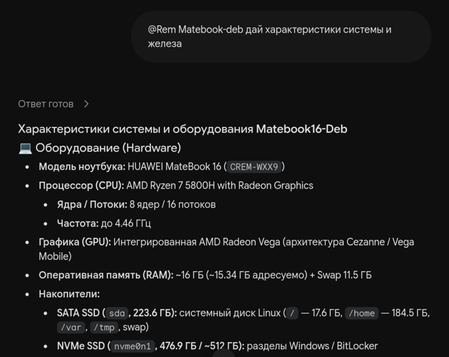
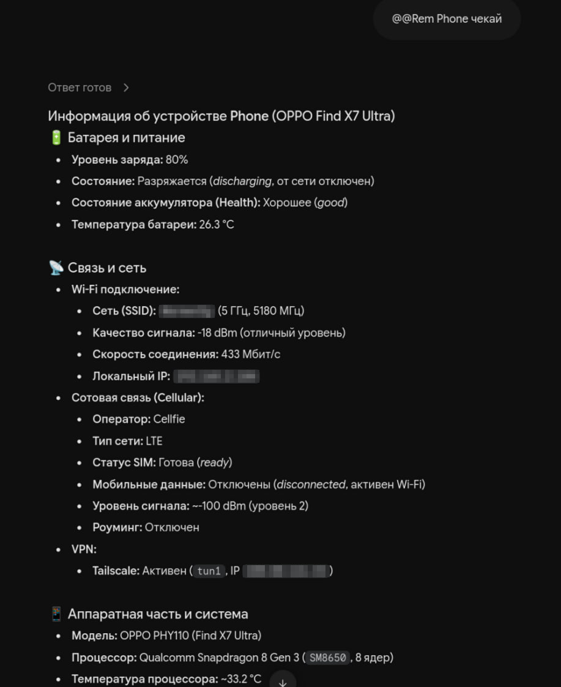
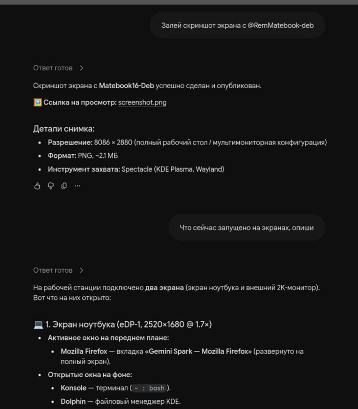

# 📱 Remote Harness MCP — control any PC from Gemini/ChatGPT/Claude (App & Web), including free accounts!

> **An open-source MCP server that turns Gemini, ChatGPT, and Claude (App & Web — including free accounts!) from a chatbot into a full-fledged remote agent.**
> Type a task on your phone or browser — your PC, laptop, server, or Android device executes it, and the model reports back with real results.

[English](README.md) | [🇷🇺 Русская версия](README_RU.md)

---

## 💡 The idea

AI assistants in a browser or on a phone can talk, but they cannot *do* anything on your computer.
**Remote Harness MCP** closes that gap. It is a free, open-source **Model Context Protocol (MCP)** server that connects to **Gemini** ([gemini.google.com/customize/connectors](https://gemini.google.com/customize/connectors) & mobile app), **ChatGPT**, and **Claude** (web & mobile, **including free accounts** via SSE / Streamable HTTP or standalone **OAuth 2.1 PKCE S256**) with a single link. After that, your assistant gets hands:

- runs shell commands and scripts (`python`, `powershell`, `bash`, `cmd`), builds and tests code;
- inspects `git_status` / `git_diff` and fetches docs with SSRF-safe `fetch_url` even without a shell;
- reads, writes, batch-reads and batch-edits files atomically, plus `read_media` (images/PDF/audio/video/OCR);
- searches files in milliseconds with SQLite FTS5 (`fs_index`), `glob_find`, and compact `grep_search`;
- starts long-running jobs, timers/cron, public file/folder shares, and reads host/phone telemetry.

```text
 📱 Gemini / ChatGPT / Claude (App & Web — including free accounts)
              │  MCP (SSE / Streamable HTTP / OAuth 2.1) over HTTPS
              ▼
     ☁️  Tailscale Funnel or --quick-tunnel  ← ingress and TLS
              │  127.0.0.1:<port>
              ▼
   💻 Your machine: the MCP node executes the task · PC · laptop · server · Android
```

Since 0.7.0 no separate relay gateway is required: the node publishes itself. Details below.

**Result:** your phone or browser becomes a remote control for every machine you own — operated directly by Gemini, ChatGPT, or Claude.

---

## 🛡️ Threat Model

Remote Harness MCP is designed to give an AI client controlled access to your own machine while minimizing unintended exposure.

**Protected by default:**
- **Loopback-only bind (`127.0.0.1`)** — the standalone server never listens on `0.0.0.0` by default; public ingress goes only through TLS (Tailscale Funnel or `--quick-tunnel` via `cloudflared`).
- **Mandatory authentication** — every MCP request requires a secret token (`MESH_TOKEN` / `lk_…`) or **OAuth 2.1 with PKCE S256** (`/.well-known/oauth-authorization-server`, `/oauth/register`, `/oauth/authorize`, `/oauth/token`); unauthenticated requests receive HTTP `401`.
- **Protected git metadata** — `write_file`, `edit_file`, and `batch_edit` block writes to `.git/hooks/*` and `.git/config`; `git_status` and `git_diff` run without a shell (`shell=False`) and with `-c core.fsmonitor=false -c core.hooksPath=`.
- **SSRF protection in `fetch_url`** — HTTPS only, every resolved IP is checked via `ipaddress` (blocking loopback, private/RFC1918, link-local, and metadata ranges), max 5 redirects, 300 KB response cap.
- **Scoped & isolated modes** — `--folder <dir>` pins workspace and write roots to one directory; `--no-shell` (`MESH_ENABLE_SHELL=0`) disables `bash_exec`, `run_script`, and `run_job`; `read_only` (`MESH_READ_ONLY=1`) blocks all mutations; Docker/Podman sandbox (`node_control(action="sandbox")`) isolates shell execution to `/workspace` with networking off by default and `--cap-drop ALL`.

**Residual risks when shell is enabled:**
- With shell execution enabled (`full` mode without `--no-shell` or Docker sandbox), anyone who holds the MCP URL/token — or a prompt-injected model session — can run arbitrary commands with the privileges of the OS user running the node.
- Treat the MCP link and token like a password. For untrusted prompts or single-project access, combine `--folder`, `--no-shell`, `read_only`, or Docker sandbox isolation (see also [docs/SANDBOX_SECURITY.md](docs/SANDBOX_SECURITY.md)).

---

## 🏗️ Architecture in 0.7.0 — the whole stack runs on your machine

**Up to and including 0.6.x** every node needed a bridge: a separate VPS with a
shared domain that terminated TLS and forwarded calls over an outbound WebSocket
tunnel. The node had no address of its own — the link named the bridge's domain and
`?user=` picked the node, so without that server the machine was unreachable.

**From 0.7.0 there is no bridge.** By default the installer puts the whole stack on
the machine itself and publishes it with **Tailscale Funnel**: the node has its own
HTTPS address `https://<node>.<your-tailnet>.ts.net`, and Gemini's calls arrive
directly at the local MCP server on `127.0.0.1:<port>`. No VPS, no domain, no DNS,
no ports opened on the router, and no second place that holds your token. The public
ingress and the TLS certificate come from Tailscale, which stays the only external
dependency.

```text
 📱 Gemini (App/Web)
        │  HTTPS  https://<node>.<tailnet>.ts.net/sse?token=…
        ▼
 ☁️  Tailscale Funnel  ← public ingress and TLS; no server or domain of your own
        │  127.0.0.1:<port>
        ▼
 💻  The MCP node on your machine: tools, files, shares, autostart
```

### What now lives on the machine

| Component | Where | Written by |
| :--- | :--- | :--- |
| MCP server | `127.0.0.1:<port>` (8096, or the next free port) | the node's autostart |
| Public address and TLS | Tailscale Funnel on 443 | `tailscale funnel --bg --https=443` |
| Token and allowed hosts | `<ConfigDir>/standalone.env` (0600) | the installer |
| What was actually registered | `<ConfigDir>/autostart.state.json` | the installer |
| File and page shares | the node itself | `share_file` / `serve_dir` |

### How installation works now

1. Start the wizard (**`install-gui.cmd`**) or the console installer
   (`install.ps1 -Mode standalone -Funnel` on Windows, `./install.sh --mode=funnel`
   on Linux/macOS). **Funnel is the default option** in both.
2. The installer installs the Tailscale client when it is missing, opens the browser
   once for the tailnet sign-in, and waits for `BackendState=Running`.
3. It reads `<node>.<tailnet>.ts.net` from `tailscale status --json` and writes
   `MESH_TOKEN`, `MESH_ALLOWED_HOSTS` and `MESH_PUBLIC_URL` into `standalone.env`.
4. It picks a free port and registers autostart: the `RemoteHarnessMCPService` task
   (SYSTEM, starts before anyone logs on, restarts on failure) or `rhm-node.vbs` at
   logon when elevation was refused. What was registered is recorded in
   `autostart.state.json`, and the wizard reports that record, not a checkbox.
5. It runs `tailscale funnel --bg --https=443 http://127.0.0.1:<port>` and checks
   that the public address answers.
6. It prints the ready link `https://<node>.<tailnet>.ts.net/sse?token=…` — that is
   what you paste into the Gemini connector. The token is already inside it.
7. Once per tailnet: allow Funnel in the ACL —
   `"nodeAttrs": [{"target": ["autogroup:member"], "attr": ["funnel"]}]`.

A reinstall restarts the running task: otherwise the old process keeps serving in its
previous mode and the Funnel answers `502`.

### How it differs from the old scheme

| | Up to 0.6.x: bridge | From 0.7.0: the node publishes itself |
| :--- | :--- | :--- |
| What you must run | a VPS with a shared domain | nothing but Tailscale |
| Public address | `https://<bridge-domain>/sse?user=<node>` | `https://<node>.<tailnet>.ts.net/sse?token=…` |
| Where TLS terminates | on the bridge | at the Tailscale Funnel ingress |
| What the middleman sees | call metadata and share payloads | only Tailscale's network ingress |
| File and page links | built by the bridge: `<domain>/<node>/<slug>/…` | built by the node: `<node>.<tailnet>/<slug>/…` |
| Where the token lives | the node's `agent.env` + the bridge registry | `standalone.env` on the machine |
| The bridge goes down | every node is unreachable at once | other machines are unaffected |
| Several machines | one domain, `?user=` selects the node | one address and one connector per node |
| Inbound ports | none (outbound tunnel) | none (Funnel accepts the ingress itself) |
| Upkeep | VPS, domain, certificates, bridge upgrades | the Tailscale client |

### What did not change

Same MCP server and tools, same access modes (`read_only` / `full`), timers and cron,
the chat goal, self-update, the `rhm` menu and the web settings page. The link is
still a secret: whoever holds it can run commands on that machine.

### If you still want the bridge

Tunnel mode is still there: `./install.sh --mode=tunnel` (or
`install.ps1 -Mode tunnel`) sets up the old shared-domain scheme, which makes sense
when you run many nodes behind one address. It is simply no longer the default, and
`rhm` now reports the address of the node that is actually installed, not what an
earlier install left behind.

### Migrating from 0.6.x

1. Run the installer again (the wizard already offers Funnel first).
2. Take the new `https://<node>.<tailnet>.ts.net/sse?token=…` link and update the
   Gemini connector — a Funnel node has its own address and token.
3. Files from the previous install (`agent.env`, `domain.env`) stay on disk as
   history: a Funnel node does not read them and never dials the bridge.
4. If the old bridge is no longer needed, its VPS can be switched off.

> ✅ **0.7.2 (stable):** includes ~50% smaller `tools/list` schemas (`MESH_TOOLSETS` profiles), shell-free `git_status`/`git_diff`/`fetch_url`, standalone **OAuth 2.1 (PKCE S256)** & `--folder`/`--no-shell`/`--quick-tunnel` mode, Windows `SO_EXCLUSIVEADDRUSE`, async rotating usage logs, and clean in-place Windows installer upgrades.

---
## 🔥 What you can do with it

Just ask Gemini in plain language, from anywhere:

- *"Check why my home server is slow and show the top processes"*
- *"Pull the latest changes in ~/projects/api, run the tests and tell me what failed"*
- *"Fix the typo in config.yaml and restart the service"*
- *"Start a full backup in the background and tell me when it's done"*
- *"How much free disk space is left on my laptop?"*
- *"Turn on the phone's torch, and tell me its battery level and signal"*

No SSH client, no terminal on your phone, no VPN — only a chat.

---

## 📸 In action

Three exchanges from one chat, each answered by a different machine on the other
side of the bridge. The phone never opened a terminal.

**The laptop describes itself** — *"@Rem Matebook-deb, give me the system and hardware specs"*:



**The phone reports its own battery, radio and VPN** — *"@Rem Phone, check"*.
The SSID and both addresses are mosaicked; everything else came from `device_info`:



**The desktop is photographed, published and read back** — *"take a screenshot of @RemMatebook-deb"*,
then *"describe what is running on the screens"*:



Every answer was produced by `system_vitals`, `device_info`, `device_capture` and
`share_file` running on the node itself — the model only ever saw tool results.

---

## ✨ Why it works this way

| | |
| :--- | :--- |
| 📱 **Mobile-first agent** | Works in the official Gemini mobile app and on the web through Gemini Spark. |
| 🖥️ **Any PC** | Linux, macOS, Windows — desktops, laptops, VPS, containers. **Android phones and tablets** run the same node inside Termux. |
| 🌐 **Behind any NAT** | The node publishes itself through Tailscale Funnel. No public IP, no port forwarding, no router setup. |
| ⚡ **One-line install** | Detects OS, architecture and device type; installs autostart (`systemd` / `launchd` / Windows task / runit + Termux:Boot on Android); copies your connection link to the clipboard. |
| 🛡️ **The link is the credential** | In Funnel mode the URL carries the node's own token (`/sse?token=…`), exactly as the installer prints it; treat the link as a password and rotate the token by reinstalling. In tunnel mode the URL carries only the rotatable **link key** (`lk_…`), while the **device token** that opens the tunnel travels in an `Authorization: Bearer` header. Everything else gets HTTP 401. |
| 🔁 **One address per machine** | Every node has its own HTTPS address `https://<node>.<tailnet>.ts.net` and its own Gemini connector; no separate relay is needed. |
| 🆓 **Free & open source** | MIT license, works with the free Gemini tier. |

---

## 🛠️ What Gemini can do on your machine (MCP tools)

**36 tools on the node (`ALL_TOOLS`), 38 through the gateway.** Every one of them runs on your machine under your own user account — the gateway only carries the calls. The two extra ones in bridge mode are the confirmed twins `system_change` (install/remove) and `system_write` (write into a system path); a standalone node does not have them. To save LLM context tokens, `tools/list` supports toolset profiles via `MESH_TOOLSETS` (`all`, `core`, `git`, `web`, `device`, `admin`) and a platform auto-profile (non-Android desktop nodes hide phone-only `device_capture` and `device_messages` by default, advertising 34 tools unless `MESH_DEVICE=1` or `MESH_TOOLSETS=all`).

### Which calls ask for your confirmation

Gemini Spark decides whether to stop and ask *"confirm this action?"* from the **MCP annotation hints** each tool advertises (`readOnlyHint`, `destructiveHint`, `idempotentHint`, `openWorldHint`). A tool advertised with no hints at all is treated as destructive by the spec's defaults — that is why a server that declares none gets a confirmation prompt on *every single call*. Here the hints are explicit:

| Class | Tools | Confirmation |
| :--- | :--- | :--- |
| Read-only | `mesh_status`, `system_info`, `system_vitals`, `get_orchestration_skill`, `list_dir`, `read_file`, `read_media`, `batch_read`, `win_places`, `grep_search`, `glob_find`, `git_status`, `git_diff`, `fetch_url`, `job_output`, `job_list`, `share_list`, `device_info` | never asked |
| Local work — commands, scripts, builds, file writes, indexing, jobs, shares, node settings, and the whole device branch | `bash_exec`, `run_script`, `run_job`, `write_file`, `edit_file`, `batch_edit`, `fs_index`, `job_kill`, `node_control`, `goal`, `schedule`, `share_file`, `serve_dir`, `unshare`, `device_control`, `device_capture`, `device_messages`, `screen_capture` | not asked |
| **Confirmed — install/delete, `sudo`, system paths** | `system_change` (installs/removes software, deletes data, runs `sudo`, edits system paths by shell), `system_write` (writes file content into a system path), `mesh_update` (installs a release) | **asked first** |

A prompt is spent on a **system change** only: `system_change`, `system_write` and `mesh_update` install, remove, delete or replace something you cannot undo in one call. Everything else runs silently, the device branch included — a camera, a microphone or an SMS list installs and removes nothing, and what still refuses such a call is the node's own switch (`MESH_DEVICE`, `MESH_DEVICE_ACTIONS`, `MESH_DEVICE_PIM`, `MESH_READ_ONLY`), which holds no matter what the client does. `unshare` is ordinary local work for the same reason: it stops a local server and removes a copy you can publish again in one call.

The mechanics matter if you also run the node in standalone mode: Gemini Spark skips its dialog only for a tool it sees as `readOnlyHint: true`, so the gateway advertises **every** non-system call that way — the shell and file twins because its classifier refuses the gated command classes, the device branch because the node refuses the call before any `termux-*` command runs. The node's own `tools/list` keeps the literal hint instead (a camera is not a read), which is why a client connected straight to `core/server.py` may still ask.

Four classes are gated, and the gateway — not the hint — enforces them, because a hint is static per tool and cannot tell `ls` from `apt install`:

1. **Installing or removing software** — package managers, uninstallers, `msiexec`, `dpkg`/`rpm`, `curl … | bash`, `iwr … | iex`.
2. **Deleting data** — `rm`, `Remove-Item`, `del`, `rd`, `shred`, `dd`, `mkfs`, `git clean -fd`, `docker rm`/`prune`, `truncate -s 0`.
3. **Running as root** — `sudo`, `doas`, `pkexec`, `runas`, `Start-Process -Verb RunAs`.
4. **System paths** — `/etc`, `/usr`, `/boot`, `/var/lib`, `/opt`, `/dev`, `C:\Windows`, `C:\Program Files`, `ProgramData`, the registry. Reads of those paths (`cat /etc/os-release`, `systemctl status`) are *not* gated, and neither is ordinary work in your own directories.

`bash_exec`/`run_job` refuse such commands and tell the model to re-issue them as `system_change`; `write_file`/`edit_file` refuse a system path and point at `system_write` (which takes the exact content, so there is no shell quoting to get wrong). The gate is moved, not removed — inspection, builds, tests, config edits in your projects and the like still run without a dialog.

The tool surface and the confirmation policy live in [gateway.py](gateway.py) (annotations, `INSTALL_COMMAND_PATTERNS` / `DELETE_COMMAND_PATTERNS`, `SYSTEM_PATH_RE`, `classify_command()`) and in [core/mcp_tools.py](core/mcp_tools.py) (`TOOL_ANNOTATIONS` for the node's own surface, which also carries the device branch's four tools); tests compare the two surfaces and pin the classifier, so a gated command cannot slip through.

> [!NOTE]
> The classifier matches a verb at the start of a command segment (after `sudo`/`env`/`timeout`/`powershell -Command` prefixes), so `echo "rm -rf /"` or `grep rm notes.txt` still run, while `curl … | bash` counts as an install. It is a UX gate, not a sandbox: for hard guarantees independent of any prompt use the node's own switches — `MESH_READ_ONLY=1` and `MESH_WRITE_ROOTS` ([core/agent.py](core/agent.py)).

### Status and host information

| Tool | What it does |
| :--- | :--- |
| `mesh_status()` | Confirms the node is reachable, with live evidence from the host itself: what kind of machine answered (`device_class`, `scenario`) and its `battery_percent`. Call it first if the machine looks offline. |
| `system_info()` | One-call host summary: OS, desktop, user, home, disks, memory, load, top processes, the current wallpaper, `command_shell` — the shell `bash_exec` will actually use — and the device blocks: battery and charging, network and signal, language, time and timezone, CPU, RAM, storage, cameras, microphones and sensors. |
| `system_vitals()` | CPU, RAM and disk metrics, plus the battery block and the thermal sensors the platform exposes. |
| `screen_capture(path)` | A PNG screenshot of the host's desktop. Windows captures through GDI, so it works on a clean install with no PowerShell and no third-party program; a headless server and the Android sandbox have no readable display, so the tool answers `available: false` with the reason instead of a black rectangle. `share_file` on the returned path publishes it as a link. |

### Shell

| Tool | What it does |
| :--- | :--- |
| `bash_exec(command, timeout_sec, max_chars, cursor)` | Runs a shell command. The shell matches the **host**, not the tool's name — `bash` on Linux/macOS, PowerShell or `cmd.exe` on Windows; check `command_shell` from `system_info()` first. Output is paginated: when it is cut, call again with `cursor=next_cursor`, nothing is dropped; output above 2 MB is spooled to a file returned in `saved_to`. `timeout_sec` is 1–120 (default 25). Disabled when `--no-shell` (`MESH_ENABLE_SHELL=0`) is active; installs/removals, `sudo` and system paths are **refused here** and have to go through `system_change`. |
| `run_script(code, lang, cwd, timeout_sec, background, max_chars)` | Writes and executes a temporary `python`, `powershell`, `bash`, or `cmd` script in one call without shell-quoting issues. Set `background=true` to hand off long pipelines to `run_job`. Disabled when `--no-shell` (`MESH_ENABLE_SHELL=0`) is active. |
| `system_change(command, timeout_sec, background, cwd, max_chars, cursor)` | Installs, removes or deletes on the host, runs privileged commands and edits system paths — the confirmed twin of `bash_exec`, and the only tool allowed to run `apt`/`dnf`/`pacman`/`pip`/`npm`/`winget`/`msiexec`/`rm`/`Remove-Item`/`sudo` or disk tools. It is advertised as destructive, so Gemini asks you first. `background=true` runs it as a job (for long installs) and returns a `job_id` for `job_output`; `cwd` applies to that mode. |

### Files

| Tool | What it does |
| :--- | :--- |
| `list_dir(path)` | Lists files and directories (workspace by default). |
| `read_file(path, start_line, end_line, max_chars, cursor)` | Reads a text file with line numbers, optionally restricted to a line range. Paginated like `bash_exec`. Automatically detects binary files (NUL-byte check in the first 8 KB) and returns a clean hint to use `read_media` instead of dumping binary garbage. |
| `batch_read(ops, max_total_chars, time_budget_ms)` | Runs up to 16 read-only calls (`list_dir`, `read_file`, `glob_find`, `grep_search`, `win_places`, `mesh_status`, `system_vitals`, `job_list`, `job_output`) in a single MCP round-trip, each with its own line range. |
| `read_media(path, offset, max_chars, max_side, max_frames, include_audio, page_start, page_end, render_pages, encoding)` | Hands the file to the model **in the content block MCP has for it**, not as raw bytes and not as a link: an image (PNG/JPEG/WebP/GIF) goes as an `image` block (base64 + `mimeType`), downscaled to fit the response; a PDF as its page text, with pages rendered to `image` blocks when there is no text layer; audio as metadata (duration, codec, rate, bitrate) plus an `audio` block when `include_audio=true`; video as metadata plus evenly spaced JPEG frames; text/JSON/CSV/logs as text with the encoding detected (UTF-8/BOM, `cp1251`, `cp1252`, `latin-1`) and a cursor for the next page. Budgets: 30 MiB file, 700 KiB and 1280 px per image, 4 frames, ~2.6 MB of base64 per answer. Heavy conversions use `ffmpeg` (frames, oversized photos) and PyMuPDF/`pdftoppm` (PDF pages); when one is missing the answer says so instead of failing silently. The text of an image is also read with OCR (`winsdk`/Windows OCR, `tesseract`, or your own `MESH_OCR_CMD`) and added to the text block — which matters because Gemini's client does not pass `image` blocks to the model yet. |
| `write_file(path, content, create_dirs, mode)` | Atomically creates or overwrites a file (temp file + `os.replace`). `mode` is POSIX-only: on Windows it is not honoured, and the result says so instead of pretending. Writes to `.git/hooks/*`, `.git/config`, and system paths are **refused** (use `system_write` for system paths). |
| `edit_file(path, old_string, new_string, expected_sha256, replace_all)` | Replaces an exact substring. `old_string` must match exactly once unless `replace_all` is set; `expected_sha256` guards against overwriting a file that changed since it was read. Blocks `.git/hooks/*`, `.git/config`, and system paths. |
| `batch_edit(ops, dry_run, stop_on_error)` | Applies up to 16 atomic `edit`/`write` operations in one MCP round-trip with optional `dry_run` validation and `.git/` + system-path protection. |
| `system_write(path, content, create_dirs, mode)` | Writes a file inside a system path (`/etc`, `/usr`, `/boot`, `/var/lib`, `C:\Windows`, `C:\Program Files`, `ProgramData`, the registry) — the confirmed twin of `write_file` and the only way to write there. Gemini asks you first. Content is exact, so there is no shell quoting to get wrong. |

### Search

| Tool | What it does |
| :--- | :--- |
| `grep_search(pattern, path, glob, limit, ignore_case, fixed, context, format)` | Recursively searches file contents with a fast bytes-level literal pre-filter, skipping binary files and heavy directories. `fixed` treats the pattern as literal text, `context` adds surrounding lines, `limit` is 1–1000 (default 200), `format="compact"` returns compact relative `path:line: text` lines (~55% fewer tokens). |
| `glob_find(pattern, path, max_depth, max_results, time_budget_ms, use_index)` | Finds files by glob pattern (`*` and `**`) with early directory pruning, a time budget, and optional SQLite FTS5 index (`use_index="auto"|"only"|"off"`). |
| `fs_index(action, roots, background, every_sec, label)` | Manages the local SQLite FTS5 file index (`status`, `refresh`, `schedule`) for instant (<30 ms) `glob_find` queries across large drives. |
| `win_places(recent_limit, top_level_limit, only_existing_recent)` | Instant (<100 ms) host snapshot without scanning disks: Known Folders (Desktop, Documents, Downloads, OneDrive), recent opened files, and top-level drive directories. |

### Git & Web (shell-free)

These read-only tools work even when `--no-shell` (`MESH_ENABLE_SHELL=0`) is active:

| Tool | What it does |
| :--- | :--- |
| `git_status(path, short, untracked, max_chars)` | Read-only `git status` executed directly (`shell=False`) with `-c core.fsmonitor=false -c core.hooksPath=`. |
| `git_diff(path, staged, stat, ref, file, max_chars)` | Read-only `git diff` without a shell (`--staged`, `--stat`, optional `ref` and `file` filter). |
| `fetch_url(url, strip_html, max_bytes, timeout_sec)` | Fetches an `https://` URL with SSRF protection (blocks loopback/private/link-local IPs), a 5-redirect cap, 300 KB limit, and optional HTML-to-text stripping. TLS trust order: operator bundle (`MESH_CA_BUNDLE`), then `certifi`, then the system store — see [docs/TLS_TRUST.md](docs/TLS_TRUST.md). |

### Long-running work

| Tool | What it does |
| :--- | :--- |
| `run_job(command, cwd)` | Starts a command in the background and returns a `job_id`. On an Android node it takes the wake lock for the lifetime of the job, so Android does not freeze it when the screen goes off. |
| `job_output(job_id, wait_ms, max_chars, cursor)` | Reads a job's output, optionally waiting up to 20 s for completion. Paginated. |
| `job_kill(job_id, signal)` | Terminates a job. `signal` is `TERM` (default), `KILL`, `INT`, `HUP` or `QUIT`. |
| `job_list(limit)` | Lists recent jobs, newest first (20 by default, max 50), including whether each one holds a `wake_lock`. |

### Device (phone, laptop or server)

These four tools read and act on the device the node itself runs on. They are advertised on **every** node — a phone-only action on a laptop answers with `available: false`, the reason and, where one exists, the fix, instead of failing.

| Tool | What it does |
| :--- | :--- |
| `device_info(section, sensor, fresh, quick)` | One-call device report: battery and charging, network interfaces with Wi-Fi and cellular signal, language, time and timezone, CPU, RAM, storage, cameras, microphones, sensors and what the platform can actually reach. `section` is `summary`, `all` (default) or one of `device`, `battery`, `network`, `locale`, `time`, `hardware`, `storage`, `cameras`, `microphones`, `sensors`, `capabilities`. `sensor` takes one live sample from a named sensor (Android; the name comes from the `sensors` block), `fresh` bypasses the few-second cache and `quick` skips the slow sections. Every block carries `available` and `source`; a block the platform cannot answer says why instead of showing a zero. |
| `device_control(action, on, value, stream, text, title, id, url, path, state, timeout_sec)` | Twenty reversible actions: `torch`, `vibrate`, `volume`, `volume_get`, `brightness`, `tts_speak`, `toast`, `notify`, `notify_list`, `notify_remove`, `clipboard_get`, `clipboard_set`, `media`, `media_scan`, `wakelock`, `download`, `open`, `share`, `dialog`, `wallpaper`. `value` is milliseconds for `vibrate`, a 0–15 level for `volume` and 0–255 for `brightness`; `stream` picks the audio stream (`music` by default); `text` is the body for TTS, toast, notification, clipboard and dialog, and `play\|pause\|stop\|info` for `media`. Nothing here is destructive. |
| `device_capture(action, camera_id, path, seconds, provider, frequency, pattern)` | Eleven actions: `camera_list`, `camera_photo`, `mic_record_start`, `mic_record_stop`, `mic_record_status`, `location`, `fingerprint`, `usb_list`, `usb_access`, `infrared_frequencies`, `infrared_transmit`. **No confirmation prompt** — it installs and removes nothing, and `MESH_DEVICE`/`MESH_DEVICE_ACTIONS`/`MESH_READ_ONLY` on the node are what refuse a call. `path` is the output file for `camera_photo` and `mic_record_start` (default: the node's capture directory) and the device path from `usb_list` for `usb_access`; `camera_id` comes from `camera_list`, `seconds` limits a recording, `provider` is `gps`, `network` or `passive`, and `frequency`/`pattern` drive `infrared_transmit`. A photo or a recording stays in the capture directory and is never uploaded by itself — `share_file` publishes it only when you ask for that. `fingerprint` returns only the verdict; `usb_access` asks Android for permission and returns the descriptor but deliberately refuses to run a program for you. |
| `device_messages(action, number, text, limit, offset, type, query)` | Five actions: `sms_list`, `sms_send`, `call_log`, `contacts`, `call`. **No confirmation prompt, and off until the operator enables it with `MESH_DEVICE_PIM=1`** — it is the private data of whoever holds the phone, so the node itself is the gate. `limit` is 1–50 (default 10), `offset` pages through the list, `type` filters it and `query` filters contacts on the node. |

Example:

```text
"Check the phone's battery and signal."
  → device_info(section="summary")

"Turn on the torch."
  → device_control(action="torch", on=true)

"Take a photo and share it with me."
  → device_capture(action="camera_photo")   # runs without a dialog
  → share_file(path=<the path it returned>)
```

### Device switches (operator)

Read from `agent.env` at startup ([core/agent.py](core/agent.py), applied in [core/mcp_tools.py](core/mcp_tools.py) and [core/device.py](core/device.py)):

| Variable | Default | What it does |
| :--- | :--- | :--- |
| `MESH_DEVICE` | `auto` | `auto` keeps the branch answering everywhere (only the answer differs per platform), `0` switches the branch off, `1` forces it on. |
| `MESH_DEVICE_ACTIONS` | empty | Comma-separated allowlist of action names for `device_control`, `device_capture` and `device_messages`; empty means every action the build implements. |
| `MESH_DEVICE_CAPTURE_DIR` | shared storage on a phone once `termux-setup-storage` has been granted (`~/storage/dcim/remote-harness-mcp` or `~/storage/shared/RemoteHarnessMCP`), otherwise `~/.cache/remote-harness-mcp/captures` | Where photos and recordings are written. |
| `MESH_DEVICE_PIM` | `0` | `1` enables SMS, the call log, contacts and placing a call. |
| `MESH_DEVICE_QUICK` | `0` | `1` keeps `system_info` instant by skipping network, cameras, microphones and sensors. |
| `MESH_READ_ONLY` | `0` | `1` makes the node observation-only: blocks `bash_exec`, `run_job`, `write_file`, `edit_file`, publishing and mutating device actions; reads (`read_file`, `list_dir`, `grep_search`, `system_info`) keep working. This is the startup guard: until the operator chooses a mode in `rhm`, `1` keeps the node read-only. An explicit menu choice (`access.mode`) is the operator's permission and the env file no longer overrides it; the tray can also flip read-only live. |

### Node settings (`node_control`)

One tool for the node's own switches — the same ones the `rhm` console menu and the cabinet change. Changes apply immediately: the agent reads them on every call, so no restart is needed.

| Action | What it does |
| :--- | :--- |
| `status` | Reports the access mode, `paused`, the working directory, isolation and the remote-control state without changing anything. |
| `mode` (`read_only` / `approval` / `full`) | The access mode. A model may **tighten** the mode but never lift read-only — that is a person's decision, in the cabinet or at the machine. |
| `cd` (`path`) | The working directory: every relative `list_dir`, `read_file`, `write_file` and `bash_exec` path resolves against it. `ls` afterwards is plain `list_dir`. |
| `pause` / `resume` | Pause: the node answers `node_paused` to everything except `status` and `resume`, while the tunnel stays up. |
| `sandbox` (`enabled`, `workspace`, `network`) | An isolated Docker/Podman container: only the project directory is mounted at `/workspace`, networking is off by default, `--cap-drop ALL`, PID and memory limits. `bash_exec` and `run_job` then execute inside it. |
| `remote_control` (`enabled`) | Allows or forbids changing these switches over the network. |

**Remote control is on by default**: the cabinet and a model may tighten the mode and move the working directory. It can be switched off from anywhere, but switched back on **only at the machine**: `rhm remote-control on`, or `r` in the `rhm` menu. Otherwise switching it off would be a request rather than a lock.

The cabinet (`/account`) shows the same switch right after login; a device is linked once with its node name and key (`lk_…` from the MCP URL, or the device token). Cabinet buttons, the menu and `rhm` subcommands go through one implementation ([core/settings.py](core/settings.py)), so they share the validation and the `settings.log` audit trail in the node's config directory.

### Confirmation belongs to the client, not to the node

The node never asks for confirmation. The “run this tool?” dialog is drawn by the MCP client — Gemini Web, ChatGPT, an IDE — and only that client decides when to show it; that is what the MCP annotations in `tools/list` are for. The node executes what it is sent and returns the result.

There are therefore two modes: `read_only` (observation; mutations are refused) and `full` (normal work). The old name `approval` is still accepted for compatibility and means `full`. The approval queue, the `a`/`A`/`x`/`R` keys in the menu and the `approve` tool are gone: if the client did not show a dialog, it does not want one.

### Timers and cron from the chat (`schedule`)

One tool call must answer within ~30 s, and an MCP server cannot wake the chat. So the model leaves long work to a timer on the node instead of waiting inside a call.

| Action | What it does |
| :--- | :--- |
| `set` + `label` + one of `after_sec` / `every_sec` / `at` | one shot, every N seconds (>=10), or daily at `HH:MM` |
| `command` | what to run when it fires: the command starts as a background job (`run_job`) and its `job_id` is kept in the continuation |
| `note` | a reminder without a command |
| `list` / `cancel` / `ack` | inspect, stop, acknowledge |

A fired timer becomes a **continuation**: it appears in `mesh_status` and is injected into the session instructions on the next `initialize` as `SCHEDULED CONTINUATION: …`. The model collects the result with `job_output` and acknowledges it with `schedule(action="ack")`. The command runs on the node even without the chat; the chat gets the result on its next turn.

From the console: `rhm schedule`, `rhm schedule cancel <id>`, `rhm schedule ack [id]`.

### Goal from the chat (`goal`) — disabled by default

One objective stored on the node would be shared by every chat: one client's task
would leak into another session. The feature is therefore off unless the operator
sets `MESH_GOAL=1`. While it is off the `goal` tool is absent from `tools/list`,
`mesh_status` returns `goal: null`, and `rhm goal` refuses to record anything
(`rhm goal clear` still deletes an already stored objective).

When enabled it is the legacy global note: `set`/`get`/`complete`/`blocked`/
`clear`, stored in `<ConfigDir>/goal.json`, injected into `initialize` and
`mesh_status`. Per-chat scoping is not implemented: the node cannot see a chat
identity.

### Publishing files and web pages

These four make something on your machine readable from the internet. Whoever exposes the node serves the link: the gateway on its shared domain (tunnel mode) or the node itself (Funnel mode), so **the node has to stay reachable** — connected to the gateway, or running behind Funnel.

The mode decides the link shape. Behind the gateway the path starts with the node name, because that is how the gateway finds the tunnel: `https://<shared-domain>/<node>/<name>-<random>/<filename>`. In Funnel mode the node is published on its own address and serves shares itself, so there is no node segment: `https://<node>.<tailnet>.ts.net/<name>-<random>/<filename>`. The installer records that address in `standalone.env` as `MESH_PUBLIC_URL`, so a link never names a gateway this node is not connected to.

| Tool | What it does |
| :--- | :--- |
| `share_file(path, name, overwrite)` | Publishes **one file**: it is copied into the node's share root and you get a link to it (see the shape above). `overwrite` replaces an existing share with the same name. |
| `serve_dir(path, name)` | Serves a **directory** in place — no copy is made. `index.html` is used when present, otherwise a directory listing is shown. Read-only (GET/HEAD only). Returns a link to the directory root (see the shape above). |
| `share_list()` | Lists active shares with their URLs, their roots, and whether the local server is running. |
| `unshare(name)` | Stops a share and revokes its link. Accepts the share name, its slug or the full URL. A file share also deletes the copy in the share root; a served directory is left untouched on disk. |

> [!IMPORTANT]
> The random part of the path **is** the credential — anyone who has the link can read the file or browse the directory. Treat a share link like a password, and `unshare` it when you are done. Size limits: 32 MiB per file by default, 64 MiB ceiling via `MESH_WEB_MAX_BYTES`.

### Agent behaviour

| Tool | What it does |
| :--- | :--- |
| `get_orchestration_skill()` | Loads the agent's current operating rules and orchestration skill. |

### Keeping the node up to date

| Tool | What it does |
| :--- | :--- |
| `mesh_update(action, force, offline, restart)` | Reports, checks for or installs a newer release of the node's own code. `status` reads local state (no network), `check` asks GitHub, `apply` downloads the payload, verifies its published SHA-256, installs it with a rollback backup and restarts the agent. |

> [!TIP]
> Nodes update themselves: a running agent checks for a newer release in the background (every 6 hours by default) and installs what it finds, and on Windows the `RemoteHarnessMCPUpdater` task checks once a day even when no agent is running. `MESH_UPDATE_AUTO=0` switches that to "report only". Details, environment variables and rollback: [docs/UPDATES.md](docs/UPDATES.md).

> [!TIP]
> Gemini gives a single tool call roughly 30 seconds. For anything longer (builds, backups, downloads) the agent uses `run_job` and polls `job_output`, so tasks never get cut off.

---

## 🚀 Quick start — 2 minutes

### 1. Install the node on the PC you want to control

**🐧 Linux / 🍎 macOS**
```bash
curl -fsSL https://raw.githubusercontent.com/LevRa7/remote-harness-mcp/main/install.sh | bash
```

**📱 Android (Termux)** — no root, works from F-Droid's Termux
```bash
curl -fsSL https://raw.githubusercontent.com/LevRa7/remote-harness-mcp/main/install.sh | bash
```
Autostart on a phone is a runit service plus the Termux:Boot app, and the node is
named after the device model — see [docs/TERMUX.md](docs/TERMUX.md).

**🪟 Windows (PowerShell)**
```powershell
irm https://raw.githubusercontent.com/LevRa7/remote-harness-mcp/main/install.ps1 | iex
```

**🪟 Windows — visual installer** (from a clone or a release)

```powershell
.\install-gui.cmd
```

A WinForms wizard that mirrors the console installer's variants, switches language at
runtime and shows the MCP link at the end — see [docs/GUI_INSTALLER.md](docs/GUI_INSTALLER.md).

**📦 Node.js (any OS)**
```bash
npx remote-harness-mcp
```

The pre-rename name still works: `npx gemini-computer-use` is an alias package
that depends on `remote-harness-mcp` and forwards every argument to the same CLI
(see [npm/gemini-computer-use](npm/gemini-computer-use/README.md)).

**🛠️ From source**
```bash
git clone https://github.com/LevRa7/remote-harness-mcp.git
cd remote-harness-mcp
./install.sh                        # Funnel mode (the default)
./install.sh --mode=tunnel          # the previous shared-gateway scheme
```

**⚡ One-folder standalone mode (no installer required)**
```bash
python3 -m core.server --folder ./my-project --no-shell --quick-tunnel
```
- `--folder <dir>` scopes workspace and write roots to a single directory.
- `--no-shell` (`MESH_ENABLE_SHELL=0`) disables `bash_exec`, `run_script`, and `run_job`, keeping file, search, `git_status`, `git_diff`, and `fetch_url` tools available.
- `--quick-tunnel` publishes the loopback server over an ephemeral `trycloudflare.com` HTTPS URL when `cloudflared` is installed.
- Standalone mode also supports **OAuth 2.1 (PKCE S256)** (`/.well-known/oauth-authorization-server`, `/oauth/authorize`, `/oauth/token`) and `MESH_TOOLSETS` filtering (`core,git,web`). Dynamic Client Registration is used by default; setting `MESH_OAUTH_CLIENT_ID`, `MESH_OAUTH_CLIENT_SECRET`, and Gemini's exact callback in `MESH_OAUTH_REDIRECT_URI` enables a pre-registered confidential Gemini client instead. The manual client gets an explicit local consent page; dynamic clients keep the existing redirect flow. Registered clients and SHA-256 digests of unexpired access tokens are stored under the private config directory so a service restart does not invalidate an active session.

At the end the installer prints your personal MCP link and copies it to the clipboard:
```text
https://<your-node-name>.<your-tailnet>.ts.net/sse?token=<your_secret_token>
```

### 2. Connect it to Gemini Spark

1. Open **[gemini.google.com/customize/connectors](https://gemini.google.com/customize/connectors)** in a browser or in the Gemini mobile app.
2. Click **Add connector** (or **Settings ⚙️ → Connectors**) and name it **MyDevice**.
3. For Gemini, use the HTTPS MCP URL without a query token: `https://<your-node-name>.<your-tailnet>.ts.net/sse`. In the default dynamic-client mode, leave **Client ID** and **Client secret** blank. In pre-registered mode, enter the `MESH_OAUTH_CLIENT_ID` and `MESH_OAUTH_CLIENT_SECRET` values from the server's private `standalone.env`, and set `MESH_OAUTH_REDIRECT_URI` to the exact Redirect Link shown by Gemini's advanced settings. When Gemini opens the authorization page, review the access requested and approve it to finish connecting.

Clients that support bearer tokens in headers can continue using the generated token link shown by the installer.

### 3. Give it a task

> *"Show system_vitals and list the 5 biggest folders in my home directory."*

That's it — Gemini is now an agent running on your machine. Repeat step 1 on other computers to control all of them from the same phone.

---

## 🖥️ Deployment modes

| Mode | Command | When to use |
| :--- | :--- | :--- |
| **Public URL via Tailscale Funnel** (default) | `./install.sh` or `./install.sh --mode=funnel` | Home PCs and laptops: an HTTPS URL on your tailnet, no server, no domain, no open port. |
| **Gateway + tunnel** | `./install.sh --mode=tunnel` | The shared-gateway scenario (mobile agents, many nodes behind one domain). |
| **Remote over SSH**
| **Local standalone** | `./install.sh --mode=standalone --port=8096` | Pure localhost FastMCP server at `http://localhost:8096/sse`, no cloud relay. |

On Windows the same variants are available in the visual installer (`.\install-gui.cmd`); local standalone stays console-only there (`.\install.ps1 -Mode standalone -Port 8096`).

On **Android/Termux** the same `./install.sh` variants work; autostart is a runit service plus the Termux:Boot app instead of systemd, and standalone stays reachable from that phone alone — see [docs/TERMUX.md](docs/TERMUX.md).

---

## 🪟 Windows installation

Windows already ships PowerShell 5.1, so there is nothing to prepare — no Python, no Node.js, no administrator rights. Both installers finish by putting the same MCP link on the clipboard.

|  | Console installer | Visual installer |
| :--- | :--- | :--- |
| Start | `irm https://raw.githubusercontent.com/LevRa7/remote-harness-mcp/main/install.ps1 \| iex` | `.\install-gui.cmd` |
| Needs | nothing but PowerShell | a clone or an unpacked release — it drives `install.ps1`, `core/` and `install.sh` |
| Variants | `-Mode tunnel` (default), `-Mode standalone`, `-User`, `-Gateway`, `-Token`, `-Port`, `-DryRun` | Quick setup, Custom setup, Remote over SSH |
| Language | `-Lang en` / `-Lang ru` | switch in the window header, or `-Lang` |

### Automatic dependencies and architecture

Nothing has to be prepared by hand first. Both installers obtain what they need, and if
they cannot, they stop with an explicit message instead of writing an autostart entry that
can never work.

| | Windows (`install.ps1`) | Linux / macOS (`install.sh`) |
| :--- | :--- | :--- |
| Python | `winget` → the python.org installer for **this** architecture → `uv` | `apt` / `dnf` / `yum` / `zypper` / `pacman` / `apk` / `xbps` / `brew` → `uv` |
| `websockets` | `pip` → `pip --user` → `ensurepip` → `uv` → a venv | `pip` → `pip --break-system-packages` → `pip --user` → `ensurepip` → `uv` → a venv |
| If all of that fails | stops, and prints the exact command to run | stops, and prints the exact command to run |

`websockets` is the only external Python requirement: `core/mcp_tools.py` and
`core/server.py` are standard library only. `uv` is fetched only when the cheaper paths
have already failed.

**The architecture decides which build is downloaded.** The installer asks the *OS*, not
the process, because a 32-bit PowerShell on 64-bit Windows reports `x86` and hides the
real value in `PROCESSOR_ARCHITEW6432`, and an emulated x64 process on ARM64 reports
`AMD64`:

| Machine | Python build | `uv` archive |
| :--- | :--- | :--- |
| Windows x64 | `python-3.12.5-amd64.exe` | `x86_64-pc-windows-msvc` |
| Windows ARM64 | `python-3.12.5-arm64.exe` | `aarch64-pc-windows-msvc` |
| Windows 32-bit | `python-3.12.5.exe` | — (uv ships no 32-bit Windows build) |
| Linux `x86_64` | the package manager's own build | `x86_64-unknown-linux-gnu` |
| Linux `aarch64` | the package manager's own build | `aarch64-unknown-linux-gnu` |
| Linux `armv7l` / `i686` | the package manager's own build | `armv7-unknown-linux-gnueabihf` / `i686-unknown-linux-gnu` |
| macOS `arm64` / `x86_64` | `brew`, or `uv` | `aarch64-apple-darwin` / `x86_64-apple-darwin` |

The interpreter that ends up pinned is the one that actually has `websockets` — which can
be a venv or a `uv`-managed CPython, both deliberately outside `PATH`. `install.ps1 -DryRun`
and `install.sh --dry-run` report the architecture without changing anything, and the visual
installer shows it in its preflight.

### Download the setup executable

The release also ships a single compiled installer, for machines where you would rather
not clone or download anything else — `RemoteHarnessMCP-Setup-<version>.exe`:

```powershell
.\RemoteHarnessMCP-Setup-0.7.2.exe            # open the visual installer
.\RemoteHarnessMCP-Setup-0.7.2.exe -Lang ru   # start in Russian
.\RemoteHarnessMCP-Setup-0.7.2.exe -SelfTest  # headless self-check, prints JSON
.\RemoteHarnessMCP-Setup-0.7.2.exe --version  # print the version
```

It carries the wizard, `install.ps1`, `core/` and `install.sh` inside itself, unpacks them
to `%LOCALAPPDATA%\RemoteHarnessMCP\setup\<version>` (override with `MESH_SETUP_DIR`) and
runs the wizard from there. It needs nothing but the .NET Framework and PowerShell that
Windows already has, and it is built from this repository by
`.\build-installer-exe.ps1` — no SDK, no NuGet, no network.

It is **not code-signed**, so SmartScreen may ask for confirmation the first time you run
it.

### Visual installer


- **Quick setup** (recommended) — node name = PC name, shared gateway domain, Windows autostart. The one to pick on a home PC or laptop.
- **Custom setup** — your own node name, your own shared domain, optional token.
- **Remote over SSH** — copy the node code to a Linux host and run `install.sh` there. Needs the Windows *OpenSSH Client* feature and key-based authentication; interactive password prompts are not supported.

The first screen runs `install.ps1 -DryRun` and reports what it found — Python, `websockets`, the resolved gateway domain, the config directory, the autostart path — without changing anything. Before starting, the window shows the exact command it will run; during the run it streams the installer output; at the end it shows the MCP link with a copy button, the three-step Gemini instructions and the paths it created.

**Where and what gets installed.** After the variant, the wizard asks for the folder: a switch between the ready drives with their free space, a path box and a *Browse...* button — any writable folder works, for example `D:\RemoteHarnessMCP`. The next screen carries three switches: autostart (a machine service at boot with the UAC prompt, a per-user entry at sign-in without admin rights, or no autostart at all), adding the `rhm` command to the user `PATH`, and Start menu plus Desktop shortcuts. They are the console installer's own switches: `-InstallDir`, `-Autostart`, `-AddToPath`, `-Shortcuts`.

Full details, screenshots and the SSH notes: [docs/GUI_INSTALLER.md](docs/GUI_INSTALLER.md).

### What a Windows installation creates

| Path | What it is |
| :--- | :--- |
| `%USERPROFILE%\.config\remote-harness-mcp\agent.env` | `MESH_GATEWAY`, `MESH_USER`, `MESH_TOKEN` |
| `%USERPROFILE%\.config\remote-harness-mcp\domain.env` | `MESH_PUBLIC_URL` — the resolved shared domain, so the node's share links, its tunnel and the gateway name the same host (not written when the built-in default is all that is configured) |
| `…\Start Menu\Programs\Startup\rhm-agent.vbs` | autostart entry, so the node comes back after a reboot |
| `%USERPROFILE%\.config\remote-harness-mcp\agent.log` | agent output, for when a silent autostart fails |
| `%LOCALAPPDATA%\Programs\RemoteHarnessMCP\bin\rhm.cmd` | the `rhm` command; `rhm.env` beside it names the payload (written with or without `-AddToPath`) |

### Language

The visual installer starts in the language of your Windows language settings — the display language and the preferred-languages list are read from the registry — and falls back to English. `-Lang ru` / `-Lang en` overrides the detection. The switch in the window header changes every label immediately.

### Troubleshooting

- **"No gateway domain configured"** — this copy was not published with a domain. Pass one: use *Custom setup* in the wizard, or `.\install.ps1 -Gateway <shared-domain>`, or set `MESH_PUBLIC_URL`.
- **Registration fails** — the installer stops *before* writing anything when the gateway cannot be reached. Check that the domain resolves, then retry with an explicit `-Gateway`.
- **`python` opens the Microsoft Store** — that is the App Execution Alias, not an interpreter. Both installers resolve a real `python.exe` by full path and ignore the alias; the wizard never pins an alias into the autostart entry.
- **The node does not come back after a reboot** — run `.\ops\doctor.ps1`: it prints the autostart interpreter, the heartbeat age, the last `agent.log` lines (including a torn final line) and the gateway's own view of this node. `.\ops\windows\agent-watchdog.ps1` performs that check once and restarts the agent; the scheduled task `RemoteHarnessMCPWatchdog` runs it every five minutes, so a dead agent comes back on its own.

### Standalone on Windows

The wizard does not offer it; use the console installer:

```powershell
.\install.ps1 -Mode standalone -Port 8096
```

That starts a local-only FastMCP server at `http://localhost:8096/sse`, generates a token (`%USERPROFILE%\.config\remote-harness-mcp\standalone.env`, user-only ACL) and puts a tokenized URL on the clipboard. The URL works only from this computer; do not publish it.

#### Public URL without a server (Tailscale Funnel)

No public IP, no port forwarding and no gateway: the node stays on loopback and `tailscale funnel` terminates TLS on the tailnet name and proxies to `127.0.0.1`.

```powershell
.\install.ps1 -Mode standalone -Port 8096 -Funnel
```

The installer resolves `<node>.<tailnet>.ts.net` from `tailscale status --json`, writes `MESH_ALLOWED_HOSTS` and `MESH_PUBLIC_URL` next to `MESH_TOKEN` in `standalone.env`, runs `tailscale funnel --bg --https=443` and prints `https://<node>.<tailnet>.ts.net/sse?token=…`.

**Autostart at logon is the default.** The node starts through `rhm-node.vbs` in the Startup folder and lives in **your own session**, which is why screen capture, the clipboard and the tray icon work. The installer records what it really registered (`autostart.state.json` in the configuration directory). Starting before anyone logs on means the machine-wide `RemoteHarnessMCPService` (SYSTEM, restarts on failure) — the wizard's "Start at system startup as a Windows service" switch, cleared by default. A SYSTEM task runs in session 0, which has no desktop: there `screen_capture` answers `available: false` and the clipboard and tray are unavailable, so tick that switch only for a machine nobody sits at. A reinstall restarts the running node: otherwise the old process keeps serving in its previous mode and the Funnel answers `502`.

The `rhm` command (the node menu) is installed into `%LOCALAPPDATA%\Programs\RemoteHarnessMCP\bin` and added to the user `PATH`: in a new PowerShell or cmd window, `rhm` is enough. The menu describes the **installed** node: in Funnel mode it prints that node's own `https://<node>.<tailnet>.ts.net/sse?token=…` and the token from `standalone.env`, not the gateway link an earlier tunnel install left in `agent.env`/`domain.env`.

Requirements and limits: Funnel must be allowed for the tailnet in the ACL (`"nodeAttrs": [{"target": ["autogroup:member"], "attr": ["funnel"]}]`); only ports 443, 8443 and 10000 are available; the URL is public, so treat the token as a password; the node must be awake.

The wizard (`install-gui.cmd`) offers the same variant as its first, pre-selected option: it installs Tailscale, opens the sign-in page, and only then publishes the node.

The other wizard variants stay available: quick (shared gateway), custom, remote SSH, the administrator service (`-AdminService`: machine-wide task, runs as SYSTEM) and the container install (`docker/`, `--container` in `install.sh`). On Linux and macOS the console installer does it with `./install.sh --mode=funnel` (Termux is the exception: Android has no `tailscaled`, so the URL stays local).

#### WSL

Inside a WSL distribution the node is installed with the same `./install.sh --mode=standalone` and takes **8097** by default: port 8096 on that machine belongs to the Windows node, and WSL2 localhost forwarding hands it to Windows. Both nodes then run side by side (`http://localhost:8096` — Windows, `http://localhost:8097` — WSL); `--port` still wins. When the distribution has no systemd, the installer writes the login hook `~/.config/remote-harness-mcp/rhm-node-autostart.sh` into `~/.profile` and `~/.bashrc` — it does nothing when the server already answers. For boot-time start on Windows, enable systemd in `/etc/wsl.conf` (`[boot] systemd=true`). The `rhm` command lands in `~/.local/bin` and on the profile `PATH`.

Opening the MCP link in a browser does not start a stream: the node recognises a browser (`Sec-Fetch-Dest: document` / `Accept: text/html`) and returns a connection card with both endpoints, the token and the steps for Gemini, ChatGPT and Claude. An MCP client sends `Accept: text/event-stream` and gets its stream exactly as before.

The authorization prompt appears **during installation**, right after the client is installed and before the node starts: the installer runs `tailscale up`, prints the `https://login.tailscale.com/a/...` link (the browser opens on its own) and waits up to five minutes for the machine to be approved.

---

## 📱 Android installation (Termux)

The same `install.sh` installs a node on an unrooted phone or tablet, and the phone
then shows up in Gemini Spark like any other machine. Full guide:
**[docs/TERMUX.md](docs/TERMUX.md)**.

```bash
# 1. Termux from F-Droid (not Google Play); optionally Termux:Boot and Termux:API
pkg update -y
# 2. the usual one-liner
curl -fsSL https://raw.githubusercontent.com/LevRa7/remote-harness-mcp/main/install.sh | bash
```

What a phone changes, and how the installer handles it:

| | |
| :--- | :--- |
| **Packages** | `pkg` instead of `apt`, `python`/`python-pip` instead of `python3-pip`/`python3-venv` — a phone is never root and has no `sudo`. |
| **Node name** | The device model (`Pixel 7 Pro` → `pixel7pro`): Android answers `localhost` to every app, and the gateway keeps one tunnel per name. |
| **Domain file** | `~/.config/remote-harness-mcp/domain.env` — there is no `/etc` to write to. The installer records the resolved shared domain there, so the phone's share links, its tunnel and the gateway name the same host (the built-in default is never recorded). |
| **Autostart** | A **runit** service (`termux-services`, the `Restart=always` equivalent) plus a **Termux:Boot** script that takes the wake lock after a reboot. |
| **Clipboard** | `termux-clipboard-set` (Termux:API), so the MCP link goes straight into the Gemini app. |

> [!IMPORTANT]
> Two Android-side switches are yours to flip: install **Termux:Boot** and open it
> once, and set battery optimisation to *Unrestricted* for Termux. Without them
> Android unloads the node with the screen off.

The phone must also be able to **resolve the gateway name**. A gateway that lives on
a private network (Tailscale, a VPN, a DNS override on your laptop) resolves there and
nowhere else — mobile data resolves nothing private. Put the phone on that network, or
give the gateway a publicly resolvable domain; the installer detects a name it cannot
resolve and says so before writing anything: see
[docs/TERMUX.md](docs/TERMUX.md#private-gateway-tailscale--vpn).

```bash
sv status rhm-agent                       # is it up?
sv restart rhm-agent                      # restart now
tail -f $PREFIX/var/log/sv/rhm-agent/current
```

`--mode=standalone` also works, but it serves `127.0.0.1` only — reachable from
inside that phone alone. Use the default tunnel mode to drive the phone from Gemini.

---

## 🔄 Automatic updates

A node installs itself from a GitHub release and then keeps itself current the same
way. You do not re-install anything by hand, and nothing unverified is installed.

- **It checks by itself.** A running agent asks the GitHub Releases API every 6
  hours (`MESH_UPDATE_CHECK_INTERVAL`), compares the tag with the version in
  `core/version.py` and installs what it finds. On Windows the daily
  `RemoteHarnessMCPUpdater` task does the same for a machine whose agent is not
  running. `MESH_UPDATE_AUTO=0` turns installing off and keeps reporting.
- **It verifies before it installs.** The payload is downloaded, its SHA-256 is
  compared with the published checksum, and only then are `core/`, `skills/` and
  `ops/` replaced. No checksum, no update.
- **It can always go back.** The replaced directories are saved under
  `%USERPROFILE%\.config\remote-harness-mcp\backups\<version>-<timestamp>\`, and an
  update interrupted by a kill or a power cut is rolled back automatically on the
  next start.
- **The node comes back new.** The agent is restarted through whatever supervises
  it (the watchdog task on Windows, `systemctl --user restart rhm-agent.service`,
  `launchctl kickstart -k`) — or started directly when nothing supervises it.

By hand, any time:

```powershell
remote-harness-mcp update -Check      # is a newer release published?
remote-harness-mcp update             # install it now and restart
remote-harness-mcp update -Check -Json
```

From Gemini: ask the node to run `mesh_update` (`status`, then `check`, then
`apply`).

The state of the last check is in the heartbeat, so `ops/doctor.ps1` shows it, and
the full history is in `%USERPROFILE%\.config\remote-harness-mcp\update.log`.
Configuration, exit codes, rollback and troubleshooting: [docs/UPDATES.md](docs/UPDATES.md).

---

## 🔗 One shared domain (canonical URL contract)

A node is **never** addressed by its own hostname. The gateway publishes a single shared domain, and the node name travels as a query parameter:

| Purpose | Canonical URL |
| :--- | :--- |
| MCP over SSE | `https://<shared-domain>/sse?user=<node-name>&token=<link-key>` |
| MCP Streamable HTTP | `https://<shared-domain>/mcp?user=<node-name>&token=<link-key>` |
| Reverse tunnel (agent) | `wss://<shared-domain>/ws/tunnel?user=<node-name>` + `Authorization: Bearer <device-token>` |

Why: every extra hostname would need its own DNS record *and* its own SAN in the TLS certificate. A node whose name is missing from the certificate fails the TLS handshake, and the Gemini client then reports an opaque "cannot connect to host". With one shared domain the certificate covers every node forever, and adding a node is only a registration call.

- The shared domain defaults to `<your-domain>`; override it with `./install.sh --domain=<shared-domain>` (node side) or `MESH_PUBLIC_URL` (gateway side).
- Legacy per-device subdomain URLs still resolve for backwards compatibility and log a deprecation warning; set `MESH_LEGACY_SUBDOMAIN=0` on the gateway to reject them outright.
- The installer now records the domain it resolved in the domain file, so the node's share links, its tunnel and the gateway all name the same host: `MESH_PUBLIC_URL=https://<shared-domain>` in `domain.env`, written in both install branches (standalone, and cloud-gateway/tunnel right after `agent.env`). The value is normalised first, the `__MESH_DOMAIN__` placeholder and an empty value are never written, the write is skipped when the file already names that host, and a file that cannot be written is not fatal — the installer prints the exact command to run by hand. The built-in default is never recorded at all: it is a fallback, not a configuration, and pinning it would stop `core/domain.py` from consulting the legacy `MESH_GATEWAY` at all, so a later change in `agent.env` would be silently ignored — nothing is lost, because with no file that same value is already the resolver's last fallback. `--dry-run` reports the file and the value it would write — including `not written (the built-in default is a fallback, not a configuration)` — and still changes nothing on disk.
- Why this matters: share links are built by `core/domain.py`, whose chain is `MESH_PUBLIC_URL` → `AGY_PUBLIC_BASE_URL` → the domain file → the built-in default, and which deliberately never reads the legacy `MESH_GATEWAY` that `agent.env` carries (only `gateway_host()`, the tunnel host, does). A node installed the normal way — `agent.env` with `MESH_GATEWAY`/`MESH_USER`/`MESH_TOKEN` and no domain file — therefore dialled the right gateway while minting links on the built-in default. On an already-installed node, re-run the installer or write the one line by hand: `mkdir -p ~/.config/remote-harness-mcp && echo 'MESH_PUBLIC_URL=https://<domain>' > ~/.config/remote-harness-mcp/domain.env`, or the same with `sudo tee /etc/remote-harness-mcp/domain.env` on Linux. Existing share links keep working; new ones use the configured domain.
- `MESH_DOMAIN_FILE` only overrides the *path*, and it belongs to the node's own configuration rather than to the installer invocation: keep it in `agent.env` (every `MESH_*` key there is exported to the node), or the domain is written into a file the node never reads. The installer creates the parent directory of whichever file is in effect. Over `--ssh=<host>` the domain resolved here is handed to the remote `install.sh` as `--domain=`, so the target records that host instead of re-resolving it (a repository copy still carrying the `__MESH_DOMAIN__` placeholder would otherwise fall back to the built-in default).

---

## 🔒 Security

- **Two credentials per node** — the *device token* opens the tunnel and is accepted only in an `Authorization: Bearer` header; the *link key* (`lk_…`) is the only credential allowed in a URL. The device token in a query string is rejected with HTTP 401.
- **Link keys rotate** — `POST /v1/devices/<node>/rotate` issues a new link key and kills the old URL; `POST /v1/devices/<node>/revoke` removes the node. Neither needs a reinstall.
- **The device token rotates too** — no reinstall. From the node's payload directory run `python3 -m core.rekey` (Windows: `cd $env:USERPROFILE\.remote-harness-mcp; python -m core.rekey`). It asks the gateway for a new token, writes it into `agent.env`, the launchd plist on macOS and the Startup launcher on Windows, restarts the supervisor (systemd / launchd / Scheduled Task / runit) and waits for the node to report online. The previous token keeps working until the node connects with the new one, so a failed restart restores the old token instead of locking the machine out. `POST /v1/devices/<node>/rotate-token/finish` retires it immediately when the old token is known to be in someone else's hands. The `remote-harness-mcp rotate` shorthand is the same command through the npm CLI.
- **Enrolment** — `/api/register` refuses to hand a token to a request that only knows a name or a MAC address; possession of the device token is required to reuse a registration. Set `MESH_REGISTER_MODE=pair` (with `MESH_ADMIN_TOKEN`) to replace self-registration entirely with the pairing flow: `POST /v1/devices/pair` → approve the code → collect the credentials.
- **Outbound-only tunnel** — nodes never listen on public ports; the agent dials out to the gateway.
- **Gateway is a relay** — it terminates TLS and forwards calls; commands run only on your node.
- **Unprivileged by default** — the agent runs in user space, without root.

> [!WARNING]
> Whoever has your MCP link can run commands on that machine. Treat it like a password: don't publish it, and rotate the link key (`POST /v1/devices/<node>/rotate`) if it leaks.

---

## 🚢 Self-hosting the gateway

The gateway is a single host serving every node. Publish it only through the deploy script, so the running gateway, the served installers and the node bootstrap payload cannot drift apart:

```bash
MESH_GATEWAY_SSH=root@<gateway-ip> ./deploy_gateway.sh              # deploy
MESH_GATEWAY_SSH=root@<gateway-ip> ./deploy_gateway.sh --dry-run    # preview
MESH_GATEWAY_SSH=root@<gateway-ip> MESH_GATEWAY_SSH_PASS_FILE=~/.ssh/gw-pass \
    ./deploy_gateway.sh                                            # password auth
```
It verifies every upload with an sha256 manifest on the host, takes a timestamped backup, installs with the right owner, restarts the service and finishes with a public health check. Nothing is installed if verification fails.

> [!TIP]
> **One place for the domain.** `MESH_PUBLIC_URL` in `domain.env`
> (`/etc/remote-harness-mcp/domain.env` on Linux, `%USERPROFILE%\.config\remote-harness-mcp\domain.env`
> on Windows) is the only setting that names it: the node, the gateway, the installers, the public
> file links and the nginx vhosts all resolve it through `core/domain.py`. Switching domains is one
> value plus `ops/nginx/render-domain.sh --apply` — see [docs/DOMAIN.md](docs/DOMAIN.md).

> [!IMPORTANT]
> **`install.ps1` encoding — one file, two representations.** The repository copy is UTF-8 *with* a BOM: Windows PowerShell 5.1 decodes a BOM-less script with the ANSI code page, the Russian strings then turn into smart quotes and the parser rejects the whole file, so `.\install.ps1` from a clone would not run. The copy the gateway serves is written *without* the BOM by `deploy_gateway.sh`, because `irm … | iex` receives the BOM as part of the first token and `param(...)` then stops being the first statement. nginx declares `charset utf-8` for that location, so the BOM-less copy still decodes correctly. Please keep both properties when editing the file.

**TLS certificate policy — one name, no per-device SANs.** The certificate must cover the shared domain only; a node is selected by `?user=`, never by a hostname:

```bash
# what the certificate currently covers
sudo certbot certificates | grep -A1 'Certificate Name: <your-domain>'

# canonical renewal check (staging, does not touch the live certificate)
sudo certbot renew --dry-run --cert-name <your-domain>
```
Legacy per-device SANs may still be present from before this contract. They are harmless and keep old bookmarked URLs working; drop them at the next renewal once no client uses subdomain URLs any more (see the `domains =` line in `/etc/letsencrypt/renewal/<name>.conf`, or re-issue with a single `-d`).

---

## 📄 License

**MIT** — see [LICENSE](LICENSE).
