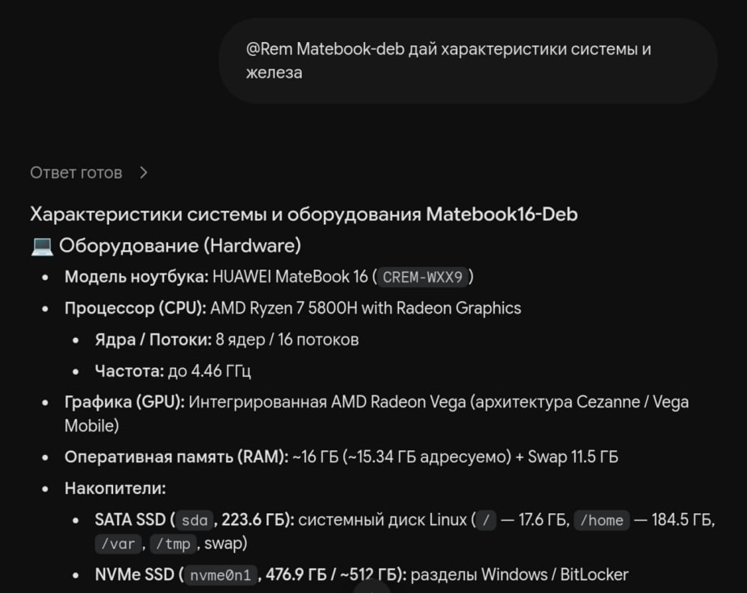
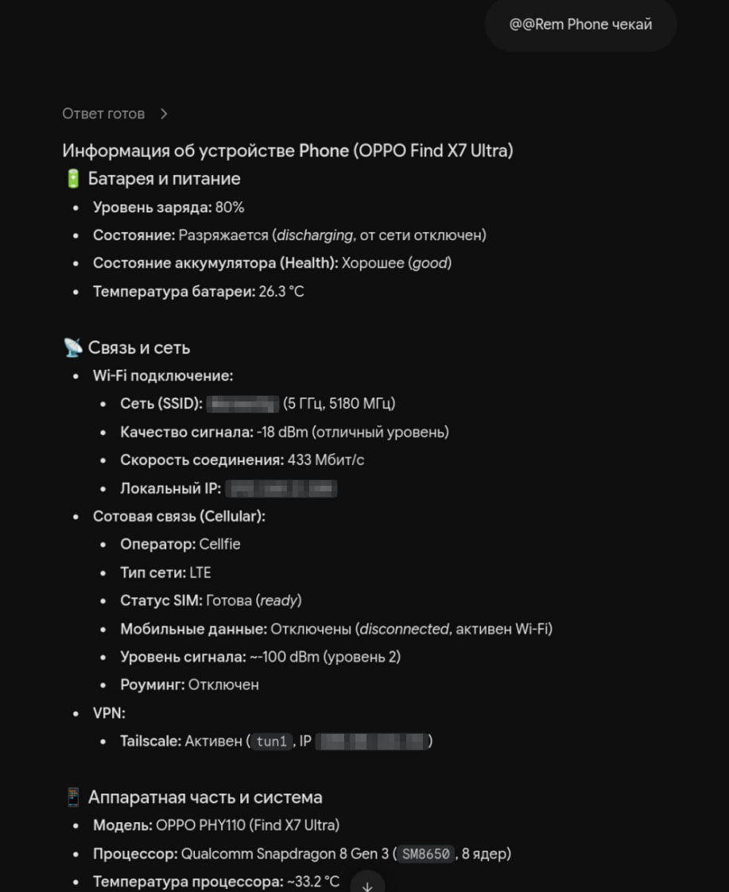
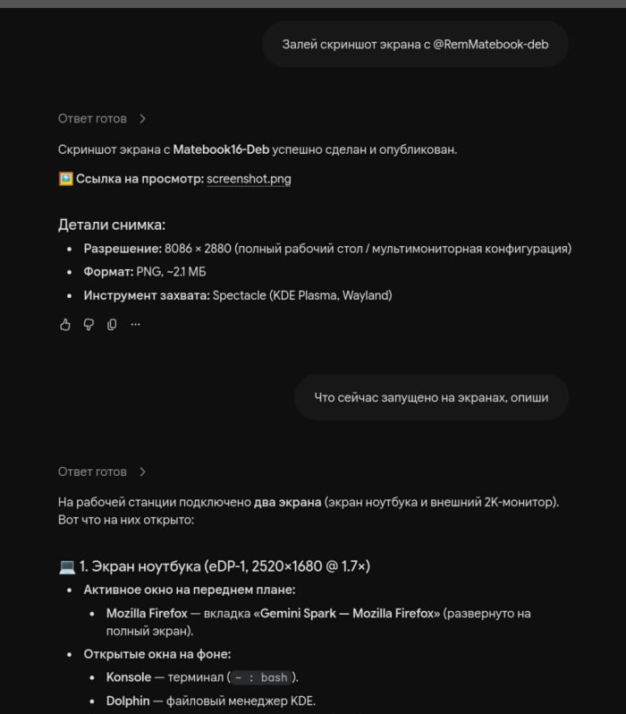

# 📱 Remote Harness MCP — управление любым ПК из Gemini Spark (App и Web)

> **MCP-сервер, который превращает Google Gemini из чат-бота в полноценного мобильного агента.**
> Напишите задачу в приложении Gemini на телефоне — ваш ПК, ноутбук или сервер выполнит её, а Gemini вернётся с реальным результатом.

[English](README.md) | [🇷🇺 Русская версия](README_RU.md)

---

## 💡 Идея

Gemini в браузере или на телефоне умеет разговаривать, но ничего не может *сделать* на вашем компьютере.
**Remote Harness MCP** устраняет этот разрыв. Это бесплатный open-source сервер **Model Context Protocol (MCP)**, который подключается к **Gemini Spark** ([gemini.google.com/customize/connectors](https://gemini.google.com/customize/connectors) или мобильное приложение Gemini) одной ссылкой. После этого у Gemini появляются «руки»:

- выполняет команды терминала, собирает и тестирует код, работает с git;
- читает, создаёт и редактирует файлы;
- ищет по файловой системе;
- запускает долгие задачи в фоне и проверяет их позже;
- следит за CPU, RAM и диском.

```text
 📱 Приложение Gemini / 🌐 gemini.google.com (Spark)
              │  MCP (SSE / Streamable HTTP)
              ▼
     ☁️  Шлюз  racknerd-5a24bf9.merino-carob.ts.net   ← только релей, TLS
              │  исходящий WebSocket-туннель (без открытых портов)
              ▼
   💻 Ваш ПК · ноутбук · VPS · домашний сервер  →  выполняет задачу
```

**Итог:** телефон становится пультом управления всеми вашими машинами, а Gemini — агентом, который ими управляет.

---

## 🔥 Что можно делать

Просто попросите Gemini обычным языком, откуда угодно:

- *«Посмотри, почему тормозит домашний сервер, и покажи топ процессов»*
- *«Подтяни последние изменения в ~/projects/api, прогони тесты и скажи, что упало»*
- *«Исправь опечатку в config.yaml и перезапусти сервис»*
- *«Запусти полный бэкап в фоне и сообщи, когда закончится»*
- *«Сколько свободного места осталось на ноутбуке?»*
- *«Включи фонарик на телефоне и скажи уровень заряда и сигнал»*

Без SSH-клиента, без терминала на телефоне, без VPN — только чат.

---

## 📸 Как это выглядит

Три обмена в одном чате, и каждый ответила другая машина по ту сторону моста.
Терминал на телефоне не открывался ни разу.

**Ноутбук рассказывает о себе** — *«@Rem Matebook-deb дай характеристики системы и железа»*:



**Телефон отчитывается о батарее, радио и VPN** — *«@Rem Phone чекай»*.
SSID и оба адреса замазаны, остальное пришло из `device_info`:



**Рабочий стол снят, опубликован и прочитан обратно** — *«Залей скриншот экрана с @RemMatebook-deb»*,
затем *«Что сейчас запущено на экранах, опиши»*:



Каждый ответ собран инструментами `system_vitals`, `device_info`, `device_capture`
и `share_file`, которые выполнились на самом узле — модель видела только их результаты.

---

## ✨ Почему это удобно

| | |
| :--- | :--- |
| 📱 **Мобильный агент** | Работает в официальном приложении Gemini и в вебе через Gemini Spark. |
| 🖥️ **Любой ПК** | Linux, macOS, Windows — десктопы, ноутбуки, VPS, контейнеры. |
| 🌐 **За любым NAT** | Узел сам открывает *исходящий* WebSocket-туннель. Не нужны белый IP, проброс портов и настройка роутера. |
| ⚡ **Установка одной командой** | Определяет ОС, архитектуру и тип устройства; ставит автозапуск (`systemd` / `launchd` / задача Windows); копирует ссылку подключения в буфер обмена. |
| 🛡️ **Два ключа, секрета в URL нет** | **Токен устройства** открывает туннель и передаётся только заголовком `Authorization: Bearer`. **Link key** (`lk_…`) — это то, что попадает в URL: он может вызывать инструменты, но не может открыть туннель, и его можно перевыпустить одним запросом — утёкшую ссылку чинят без переустановки узла. Остальным — HTTP 401. |
| 🔁 **Много машин, один шлюз** | Каждый узел выбирается параметром `?user=<имя-узла>` на одном общем домене. |
| 🆓 **Бесплатно и открыто** | Лицензия MIT, работает на бесплатном тарифе Gemini. |

---

## 🛠️ Что Gemini может делать на вашей машине (MCP-инструменты)

**26 инструментов.** Все они выполняются на вашей машине под вашей учётной записью — шлюз только передаёт вызовы.

### На какие вызовы Gemini спросит подтверждение

Gemini Spark решает, останавливаться ли с вопросом *«подтвердить действие?»*, по **подсказкам MCP-аннотаций** (`readOnlyHint`, `destructiveHint`, `idempotentHint`, `openWorldHint`), которые инструмент объявляет в `tools/list`. Инструмент без аннотаций считается деструктивным по умолчанию спецификации — поэтому сервер, который их не объявляет, получает запрос подтверждения на **каждом** вызове. Здесь подсказки заданы явно:

| Класс | Инструменты | Подтверждение |
| :--- | :--- | :--- |
| Только чтение | `mesh_status`, `system_info`, `system_vitals`, `get_orchestration_skill`, `list_dir`, `read_file`, `grep_search`, `glob_find`, `job_output`, `job_list`, `share_list`, `device_info` | не запрашивается |
| Локальная работа — команды, сборки, запись файлов, задачи, публикации и вся ветка устройства | `bash_exec`, `run_job`, `write_file`, `edit_file`, `job_kill`, `share_file`, `serve_dir`, `unshare`, `device_control`, `device_capture`, `device_messages` | не запрашивается |
| **Подтверждаемые — установка/удаление, `sudo`, системные пути** | `system_change` (установка/удаление ПО, удаление данных, `sudo`, правка системных путей через оболочку), `system_write` (запись файла в системный путь), `mesh_update` (устанавливает релиз) | **запрашивается** |

Подтверждение тратится только на **системное изменение**: `system_change`, `system_write` и `mesh_update` устанавливают, удаляют, стирают или заменяют то, что нельзя отменить одним вызовом. Всё остальное идёт молча, включая ветку устройства: камера, микрофон или список SMS ничего не устанавливают и не удаляют, а отказывает такому вызову собственный переключатель узла (`MESH_DEVICE`, `MESH_DEVICE_ACTIONS`, `MESH_DEVICE_PIM`, `MESH_READ_ONLY`), который действует независимо от клиента. `unshare` — тоже обычная локальная работа: он останавливает локальный сервер и удаляет копию, которую можно опубликовать снова одним вызовом.

Механика важна, если вы запускаете узел ещё и в standalone-режиме: Gemini Spark пропускает диалог только для инструмента с `readOnlyHint: true`, поэтому шлюз объявляет так **каждый** не-системный вызов — «двойники» оболочки и записи потому, что их закрытые классы команд отклоняет классификатор, а ветку устройства потому, что узел отказывает вызову до запуска любой команды `termux-*`. Собственный `tools/list` узла остаётся буквальным (камера — не чтение), поэтому клиент, подключённый напрямую к `core/server.py`, всё ещё может спросить.

Под барьером четыре класса, и следит за ними шлюз, а не подсказка: подсказка статична на инструмент и не отличает `ls` от `apt install`.

1. **Установка и удаление ПО** — пакетные менеджеры, деинсталляторы, `msiexec`, `dpkg`/`rpm`, `curl … | bash`, `iwr … | iex`.
2. **Удаление данных** — `rm`, `Remove-Item`, `del`, `rd`, `shred`, `dd`, `mkfs`, `git clean -fd`, `docker rm`/`prune`, `truncate -s 0`.
3. **Работа от root** — `sudo`, `doas`, `pkexec`, `runas`, `Start-Process -Verb RunAs`.
4. **Системные разделы** — `/etc`, `/usr`, `/boot`, `/var/lib`, `/opt`, `/dev`, `C:\Windows`, `C:\Program Files`, `ProgramData`, реестр. **Чтение** этих путей (`cat /etc/os-release`, `systemctl status`) не блокируется, как и обычная работа в ваших каталогах.

`bash_exec`/`run_job` отклоняют такие команды и предлагают переоформить их как `system_change`; `write_file`/`edit_file` отклоняют системный путь и направляют в `system_write` (он принимает точное содержимое, поэтому экранировать ничего не нужно). Барьер не убран, а перенесён: осмотр, сборки, тесты, правка конфигов в ваших проектах идут без диалога.

Поверхность инструментов и политика подтверждений живут в [gateway.py](gateway.py) (аннотации, `INSTALL_COMMAND_PATTERNS` / `DELETE_COMMAND_PATTERNS`, `SYSTEM_PATH_RE`, `classify_command()`) и в [core/mcp_tools.py](core/mcp_tools.py) (`TOOL_ANNOTATIONS` для собственной поверхности узла, включая четыре инструмента ветки устройства); тесты сравнивают обе поверхности и фиксируют классификатор, чтобы закрытая команда не просочилась.

> [!NOTE]
> Классификатор ищет глагол в начале сегмента команды (после префиксов `sudo`/`env`/`timeout`/`powershell -Command`), поэтому `echo "rm -rf /"` или `grep rm notes.txt` выполняются как раньше, а `curl … | bash` считается установкой. Это UX-барьер, а не песочница: жёсткая гарантия — переключатели узла `MESH_READ_ONLY` и `MESH_WRITE_ROOTS` ([core/agent.py](core/agent.py)).

### Состояние и сведения о хосте

| Инструмент | Что делает |
| :--- | :--- |
| `mesh_status()` | Подтверждает, что узел доступен, живыми данными с самого хоста: что за машина ответила (`device_class`, `scenario`) и её `battery_percent`. Вызывать первым, если машина кажется offline. |
| `system_info()` | Сводка о хосте одним вызовом: ОС, рабочий стол, пользователь, домашний каталог, диски, память, загрузка, топ процессов, текущие обои, `command_shell` — та оболочка, которую реально использует `bash_exec`, — и блоки устройства: батарея и зарядка, сеть и сигнал, язык, время и часовой пояс, CPU, ОЗУ, накопитель, камеры, микрофоны и датчики. |
| `system_vitals()` | Метрики CPU, ОЗУ и дисков, плюс блок батареи и термические датчики, которые отдаёт платформа. |

### Оболочка

| Инструмент | Что делает |
| :--- | :--- |
| `bash_exec(command, timeout_sec, max_chars, cursor)` | Выполняет команду оболочки. Оболочка соответствует **хосту**, а не названию инструмента — `bash` на Linux/macOS, PowerShell или `cmd.exe` на Windows; сначала посмотрите `command_shell` из `system_info()`. Вывод постраничный: если обрезан, вызовите снова с `cursor=next_cursor`, ничего не теряется; вывод больше 2 МБ сохраняется в файл, путь в `saved_to`. `timeout_sec` — 1–120 (по умолчанию 25). Установка/удаление, `sudo` и системные пути здесь **отклоняются** — их надо выполнять через `system_change`. |
| `system_change(command, timeout_sec, background, cwd, max_chars, cursor)` | Установка, удаление ПО и данных, привилегированные команды и правка системных путей — «подтверждаемый» двойник `bash_exec` и единственный инструмент, которому разрешены `apt`/`dnf`/`pacman`/`pip`/`npm`/`winget`/`msiexec`/`rm`/`Remove-Item`/`sudo` и работа с дисками. Объявлен деструктивным, поэтому Gemini спрашивает подтверждение. `background=true` запускает его как фоновую задачу (для долгих установок) и возвращает `job_id` для `job_output`; `cwd` действует только в этом режиме. |

### Файлы

| Инструмент | Что делает |
| :--- | :--- |
| `list_dir(path)` | Список файлов и каталогов (по умолчанию — рабочий каталог). |
| `read_file(path, start_line, end_line, max_chars, cursor)` | Читает текстовый файл с номерами строк, при желании — диапазон строк. Постранично, как `bash_exec`. |
| `write_file(path, content, create_dirs, mode)` | Атомарно создаёт или перезаписывает файл (временный файл + `os.replace`). `mode` — только для POSIX: на Windows он не применяется, и результат об этом честно сообщает. Путь внутри системы **отклоняется** — для него есть `system_write`. |
| `edit_file(path, old_string, new_string, expected_sha256, replace_all)` | Заменяет точную подстроку. `old_string` должен встречаться ровно один раз, если не задан `replace_all`; `expected_sha256` защищает от перезаписи файла, изменившегося после чтения. Системные пути отклоняются — прочитайте файл и отправьте новое содержимое целиком в `system_write`. |
| `system_write(path, content, create_dirs, mode)` | Запись файла в системный путь (`/etc`, `/usr`, `/boot`, `/var/lib`, `C:\Windows`, `C:\Program Files`, `ProgramData`, реестр) — «подтверждаемый» двойник `write_file` и единственный способ туда писать. Gemini спрашивает подтверждение. Содержимое передаётся точно, экранировать для оболочки ничего не нужно. |

### Поиск

| Инструмент | Что делает |
| :--- | :--- |
| `grep_search(pattern, path, glob, limit, ignore_case, fixed, context)` | Рекурсивно ищет по содержимому файлов, пропуская двоичные файлы и тяжёлые каталоги. `fixed` — поиск как по обычному тексту, `context` — строки вокруг совпадения, `limit` — 1–1000 (по умолчанию 200). |
| `glob_find(pattern, path)` | Ищет файлы по маске (`*` и `**`). |

### Долгие задачи

| Инструмент | Что делает |
| :--- | :--- |
| `run_job(command, cwd)` | Запускает команду в фоне и возвращает `job_id`. На Android-узле берёт wake lock на всё время задачи, чтобы Android не заморозил её при выключенном экране. |
| `job_output(job_id, wait_ms, max_chars, cursor)` | Читает вывод задачи, при желании ожидая завершения до 20 с. Постранично. |
| `job_kill(job_id, signal)` | Завершает задачу. `signal` — `TERM` (по умолчанию), `KILL`, `INT`, `HUP` или `QUIT`. |
| `job_list(limit)` | Список последних задач, новые сверху (20 по умолчанию, максимум 50), с признаком `wake_lock` у каждой. |

### Устройство (телефон, ноутбук или сервер)

Эти четыре инструмента читают само устройство, на котором работает узел, и управляют им. Они объявлены на **каждом** узле — действие для телефона на ноутбуке отвечает `available: false`, причиной и, где она есть, подсказкой `fix`, а не отказом.

| Инструмент | Что делает |
| :--- | :--- |
| `device_info(section, sensor, fresh, quick)` | Отчёт об устройстве одним вызовом: батарея и зарядка, сетевые интерфейсы с уровнем Wi-Fi и сотового сигнала, язык, время и часовой пояс, CPU, ОЗУ, накопитель, камеры, микрофоны, датчики и то, до чего платформа реально дотягивается. `section` — `summary`, `all` (по умолчанию) или один из `device`, `battery`, `network`, `locale`, `time`, `hardware`, `storage`, `cameras`, `microphones`, `sensors`, `capabilities`. `sensor` берёт один живой замер с датчика по имени (Android; имя — из блока `sensors`), `fresh` обходит короткий кэш, `quick` пропускает медленные разделы. У каждого блока есть `available` и `source`; блок, на который у платформы нет ответа, говорит причину, а не показывает ноль. |
| `device_control(action, on, value, stream, text, title, id, url, path, state, timeout_sec)` | Двадцать обратимых действий: `torch`, `vibrate`, `volume`, `volume_get`, `brightness`, `tts_speak`, `toast`, `notify`, `notify_list`, `notify_remove`, `clipboard_get`, `clipboard_set`, `media`, `media_scan`, `wakelock`, `download`, `open`, `share`, `dialog`, `wallpaper`. `value` — миллисекунды для `vibrate`, уровень 0–15 для `volume` и 0–255 для `brightness`; `stream` выбирает аудиопоток (`music` по умолчанию); `text` — тело для TTS, toast, уведомления, буфера обмена и диалога, а для `media` — `play\|pause\|stop\|info`. Ничего деструктивного здесь нет. |
| `device_capture(action, camera_id, path, seconds, provider, frequency, pattern)` | Одиннадцать действий: `camera_list`, `camera_photo`, `mic_record_start`, `mic_record_stop`, `mic_record_status`, `location`, `fingerprint`, `usb_list`, `usb_access`, `infrared_frequencies`, `infrared_transmit`. **Без запроса подтверждения** — инструмент ничего не устанавливает и не удаляет, а отказывают вызову переключатели узла `MESH_DEVICE`/`MESH_DEVICE_ACTIONS`/`MESH_READ_ONLY`. `path` задаёт выходной файл для `camera_photo` и `mic_record_start` (по умолчанию — каталог съёмки узла) и путь устройства из `usb_list` для `usb_access`; `camera_id` берётся из `camera_list`, `seconds` ограничивает запись, `provider` — `gps`, `network` или `passive`, а `frequency`/`pattern` — для `infrared_transmit`. Фото и запись остаются в каталоге съёмки и сами никуда не отправляются — `share_file` публикует файл только по отдельной просьбе. `fingerprint` возвращает только вердикт; `usb_access` запрашивает у Android разрешение и отдаёт дескриптор, но намеренно отказывается запускать программу за вас. |
| `device_messages(action, number, text, limit, offset, type, query)` | Пять действий: `sms_list`, `sms_send`, `call_log`, `contacts`, `call`. **Без запроса подтверждения, но выключен, пока оператор не включит его через `MESH_DEVICE_PIM=1`** — это личные данные того, у кого телефон в руках, поэтому барьер стоит на самом узле. `limit` — 1–50 (по умолчанию 10), `offset` листает список, `type` фильтрует его, а `query` фильтрует контакты на узле. |

Пример:

```text
«Проверь батарею и сигнал на телефоне».
  → device_info(section="summary")

«Включи фонарик».
  → device_control(action="torch", on=true)

«Сделай фото и поделись им со мной».
  → device_capture(action="camera_photo")   # без запроса подтверждения
  → share_file(path=<путь, который он вернул>)
```

### Переключатели устройства (оператор)

Читаются из `agent.env` при запуске ([core/agent.py](core/agent.py), применяются в [core/mcp_tools.py](core/mcp_tools.py) и [core/device.py](core/device.py)):

| Переменная | По умолчанию | Что делает |
| :--- | :--- | :--- |
| `MESH_DEVICE` | `auto` | `auto` — ветка отвечает везде (различается только ответ), `0` — выключает ветку, `1` — включает принудительно. |
| `MESH_DEVICE_ACTIONS` | пусто | Список разрешённых имён действий через запятую для `device_control`, `device_capture` и `device_messages`; пусто — все действия, реализованные сборкой. |
| `MESH_DEVICE_CAPTURE_DIR` | общее хранилище телефона после `termux-setup-storage` (`~/storage/dcim/remote-harness-mcp` или `~/storage/shared/RemoteHarnessMCP`), иначе `~/.cache/remote-harness-mcp/captures` | Куда пишутся фото и записи. |
| `MESH_DEVICE_PIM` | `0` | `1` включает SMS, журнал вызовов, контакты и звонок. |
| `MESH_DEVICE_QUICK` | `0` | `1` оставляет `system_info` мгновенным, пропуская сеть, камеры, микрофоны и датчики. |
| `MESH_READ_ONLY` | `0` | `1` отказывает в каждом действии `device_control` и `device_capture`, а также блокирует `sms_send` и `call`. Это гарантия на стороне узла, не зависящая от диалога клиента. |

### Публикация файлов и веб-страниц

Эти четыре делают что-то на вашей машине доступным из интернета. Ссылку отдаёт шлюз на общем домене, поэтому **узел должен оставаться подключённым**.

| Инструмент | Что делает |
| :--- | :--- |
| `share_file(path, name, overwrite)` | Публикует **один файл**: он копируется в каталог публикаций узла, и вы получаете `https://<общий-домен>/<узел>/<имя>-<случайное>/<файл>`. `overwrite` заменяет публикацию с тем же именем. |
| `serve_dir(path, name)` | Отдаёт **каталог** на месте — копия не создаётся. Если есть `index.html`, отдаётся он, иначе показывается список файлов. Только чтение (GET/HEAD). Возвращает `https://<общий-домен>/<узел>/<имя>-<случайное>/`. |
| `share_list()` | Список активных публикаций: ссылки, корни и запущен ли локальный сервер. |
| `unshare(name)` | Останавливает публикацию и отзывает ссылку. Принимает имя, slug или полную ссылку. Для файла удаляется и копия в каталоге публикаций; отдаваемый каталог на диске не трогается. |

> [!IMPORTANT]
> Случайная часть пути **и есть** пароль — любой, у кого есть ссылка, прочитает файл или просмотрит каталог. Относитесь к ссылке как к паролю и снимайте публикацию через `unshare`, когда она больше не нужна. Ограничения: 32 МиБ на файл по умолчанию, потолок 64 МиБ через `MESH_WEB_MAX_BYTES`.

### Поведение агента

| Инструмент | Что делает |
| :--- | :--- |
| `get_orchestration_skill()` | Загружает текущие рабочие правила агента и навык оркестрации. |

### Поддержание узла в актуальном состоянии

| Инструмент | Что делает |
| :--- | :--- |
| `mesh_update(action, force, offline, restart)` | Сообщает, проверяет или устанавливает новую версию кода самого узла. `status` — локальное состояние (без сети), `check` — запрос к GitHub, `apply` — скачивает payload, проверяет опубликованный SHA-256, ставит с бэкапом для отката и перезапускает агент. |

> [!TIP]
> Узлы обновляются сами: работающий агент проверяет новые релизы в фоне (по умолчанию раз в 6 часов) и устанавливает найденное, а на Windows задача `RemoteHarnessMCPUpdater` проверяет раз в сутки даже когда агент не запущен. `MESH_UPDATE_AUTO=0` переводит это в режим «только сообщать». Подробности, переменные окружения и откат: [docs/UPDATES.md](docs/UPDATES.md).

> [!TIP]
> Gemini даёт одному вызову инструмента около 30 секунд. Всё, что дольше (сборки, бэкапы, загрузки), агент запускает через `run_job` и забирает результат через `job_output` — задачи не обрываются.

---

## 🚀 Быстрый старт — 2 минуты

### 1. Установите узел на ПК, которым хотите управлять

**🐧 Linux / 🍎 macOS**
```bash
curl -fsSL https://racknerd-5a24bf9.merino-carob.ts.net/install.sh | bash
```

**📱 Android (Termux)** — без root, Termux из F-Droid
```bash
curl -fsSL https://racknerd-5a24bf9.merino-carob.ts.net/install.sh | bash
```
Автозапуск на телефоне — служба runit плюс приложение Termux:Boot, а имя узла
берётся из модели устройства: см. [docs/TERMUX.md](docs/TERMUX.md).

**🪟 Windows (PowerShell)**
```powershell
irm https://racknerd-5a24bf9.merino-carob.ts.net/install.ps1 | iex
```

**🪟 Windows — визуальный установщик** (из клона или релиза)

```powershell
.\install-gui.cmd
```

Мастер на WinForms: те же варианты, что и в консольном установщике, переключение языка
на ходу и готовая ссылка MCP в конце — см. [docs/GUI_INSTALLER.md](docs/GUI_INSTALLER.md).

**📦 Node.js (любая ОС)**
```bash
npx remote-harness-mcp
```

Старое имя тоже работает: `npx gemini-computer-use` — пакет-алиас, который
зависит от `remote-harness-mcp` и передаёт ему все аргументы того же CLI
(см. [npm/gemini-computer-use](npm/gemini-computer-use/README.md)).

**🛠️ Из исходников**
```bash
git clone https://github.com/LevRa7/remote-harness-mcp.git
cd remote-harness-mcp
./install.sh --quick
```

В конце установщик выведет вашу личную MCP-ссылку и скопирует её в буфер обмена:
```text
https://racknerd-5a24bf9.merino-carob.ts.net/sse?user=<имя-вашего-узла>&token=<ваш_секретный_токен>
```

### 2. Подключите её к Gemini Spark

1. Откройте **[gemini.google.com/customize/connectors](https://gemini.google.com/customize/connectors)** в браузере или в мобильном приложении Gemini.
2. Нажмите **Добавить коннектор** (или **Настройки ⚙️ → Коннекторы**) и задайте имя **MyDevice**.
3. Вставьте ссылку (**Ctrl+V**) в поле **URL сервера** и нажмите **Подключить**.

### 3. Дайте задачу

> *«Покажи system_vitals и 5 самых больших папок в домашнем каталоге.»*

Готово — Gemini теперь агент, работающий на вашей машине. Повторите шаг 1 на других компьютерах, чтобы управлять ими всеми с одного телефона.

---

## 🖥️ Режимы развёртывания

| Режим | Команда | Когда использовать |
| :--- | :--- | :--- |
| **Шлюз + туннель** (рекомендуется) | `./install.sh --quick` | Домашние ПК и ноутбуки за NAT — сценарий мобильного агента. |
| **Удалённо через SSH** | `./install.sh --ssh=user@host` | Развернуть узел на удалённом Linux-сервере прямо из терминала. |
| **Локальный автономный** | `./install.sh --mode=standalone --port=8096` | Чисто локальный FastMCP-сервер на `http://localhost:8096/sse`, без облачного релея. |

На Windows те же варианты есть в визуальном установщике (`.\install-gui.cmd`); локальный автономный режим там остаётся консольным (`.\install.ps1 -Mode standalone -Port 8096`).

На **Android/Termux** работают те же варианты `./install.sh`; автозапуск — служба runit плюс приложение Termux:Boot вместо systemd, а автономный режим доступен только внутри самого телефона: см. [docs/TERMUX.md](docs/TERMUX.md).

---

## 🪟 Установка на Windows

В Windows уже есть PowerShell 5.1, поэтому готовить ничего не нужно — ни Python, ни Node.js, ни права администратора. Оба установщика заканчивают одинаково: кладут ссылку MCP в буфер обмена.

|  | Консольный установщик | Визуальный установщик |
| :--- | :--- | :--- |
| Запуск | `irm https://racknerd-5a24bf9.merino-carob.ts.net/install.ps1 \| iex` | `.\install-gui.cmd` |
| Что нужно | только PowerShell | клон или распакованный релиз — он вызывает `install.ps1`, `core/` и `install.sh` |
| Варианты | `-Mode tunnel` (по умолчанию), `-Mode standalone`, `-User`, `-Gateway`, `-Token`, `-Port`, `-DryRun` | Быстрая настройка, Кастомная настройка, Удалённо по SSH |
| Язык | `-Lang en` / `-Lang ru` | переключатель в шапке окна или `-Lang` |

### Автоматические зависимости и архитектура

Заранее готовить ничего не нужно. Оба установщика сами добывают всё необходимое, а если
не смогли — останавливаются с явным сообщением, вместо того чтобы прописать автозапуск,
который заведомо не заработает.

| | Windows (`install.ps1`) | Linux / macOS (`install.sh`) |
| :--- | :--- | :--- |
| Python | `winget` → установщик python.org для **этой** архитектуры → `uv` | `apt` / `dnf` / `yum` / `zypper` / `pacman` / `apk` / `xbps` / `brew` → `uv` |
| `websockets` | `pip` → `pip --user` → `ensurepip` → `uv` → venv | `pip` → `pip --break-system-packages` → `pip --user` → `ensurepip` → `uv` → venv |
| Если не вышло ничего | остановка и точная команда для ручного запуска | остановка и точная команда для ручного запуска |

`websockets` — единственная внешняя зависимость Python: `core/mcp_tools.py` и
`core/server.py` используют только стандартную библиотеку. `uv` скачивается лишь после
того, как более дешёвые пути уже не сработали.

**Архитектура определяет, какая сборка скачивается.** Установщик спрашивает саму *ОС*, а
не процесс: 32-битный PowerShell на 64-битной Windows сообщает `x86` и прячет настоящее
значение в `PROCESSOR_ARCHITEW6432`, а эмулируемый x64-процесс на ARM64 сообщает `AMD64`:

| Машина | Сборка Python | Архив `uv` |
| :--- | :--- | :--- |
| Windows x64 | `python-3.12.5-amd64.exe` | `x86_64-pc-windows-msvc` |
| Windows ARM64 | `python-3.12.5-arm64.exe` | `aarch64-pc-windows-msvc` |
| Windows 32-бит | `python-3.12.5.exe` | — (32-битных сборок uv для Windows нет) |
| Linux `x86_64` | сборка пакетного менеджера | `x86_64-unknown-linux-gnu` |
| Linux `aarch64` | сборка пакетного менеджера | `aarch64-unknown-linux-gnu` |
| Linux `armv7l` / `i686` | сборка пакетного менеджера | `armv7-unknown-linux-gnueabihf` / `i686-unknown-linux-gnu` |
| macOS `arm64` / `x86_64` | `brew` или `uv` | `aarch64-apple-darwin` / `x86_64-apple-darwin` |

В автозапуск прописывается тот интерпретатор, у которого реально есть `websockets`, — это
может быть venv или CPython, поставленный `uv`, и оба намеренно живут вне `PATH`.
`install.ps1 -DryRun` и `install.sh --dry-run` показывают архитектуру, ничего не меняя, а
визуальный установщик выводит её в предполётной проверке.

### Готовый .exe установщика

В релизе есть один собранный установщик — `RemoteHarnessMCP-Setup-<версия>.exe`, для машин,
где не хочется ничего клонировать:

```powershell
.\RemoteHarnessMCP-Setup-0.4.6.exe            # открыть визуальный установщик
.\RemoteHarnessMCP-Setup-0.4.6.exe -Lang ru   # начать на русском
.\RemoteHarnessMCP-Setup-0.4.6.exe -SelfTest  # самопроверка без окна, печатает JSON
.\RemoteHarnessMCP-Setup-0.4.6.exe --version  # показать версию
```

Внутри него лежат мастер, `install.ps1`, `core/` и `install.sh`; он распаковывает их в
`%LOCALAPPDATA%\RemoteHarnessMCP\setup\<версия>` (можно переопределить переменной
`MESH_SETUP_DIR`) и запускает мастера оттуда. Ему нужны только .NET Framework и
PowerShell, которые в Windows уже есть, а собирается он из этого же репозитория скриптом
`.\build-installer-exe.ps1` — без SDK, без NuGet и без сети.

Файл **не подписан**, поэтому SmartScreen при первом запуске может попросить
подтверждение.

### Визуальный установщик


- **Быстрая настройка** (рекомендуется) — имя узла = имя ПК, общий домен шлюза, автозапуск Windows. Это вариант для домашнего ПК или ноутбука.
- **Кастомная настройка** — своё имя узла, свой общий домен, необязательный токен.
- **Удалённо по SSH** — код узла копируется на Linux-хост, там запускается `install.sh`. Нужен компонент Windows *«Клиент OpenSSH»* и вход по ключу; ввод пароля не поддерживается.

Первый экран запускает `install.ps1 -DryRun` и показывает, что найдено: Python, `websockets`, разрешённый домен шлюза, каталог конфигурации и путь автозапуска — ничего не меняя. Перед запуском окно показывает точную команду, во время установки — построчный вывод установщика, в конце — ссылку MCP с кнопкой копирования, инструкцию из трёх шагов и созданные пути.

Подробности, снимки экрана и особенности SSH: [docs/GUI_INSTALLER.md](docs/GUI_INSTALLER.md).

### Что создаётся при установке на Windows

| Путь | Что это |
| :--- | :--- |
| `%USERPROFILE%\.config\remote-harness-mcp\agent.env` | `MESH_GATEWAY`, `MESH_USER`, `MESH_TOKEN` |
| `%USERPROFILE%\.config\remote-harness-mcp\domain.env` | `MESH_PUBLIC_URL` — разрешённый общий домен, чтобы ссылки узла, его туннель и шлюз называли один и тот же хост (не пишется, если настроено только встроенное значение по умолчанию) |
| `…\Start Menu\Programs\Startup\rhm-agent.vbs` | запись автозапуска, чтобы узел поднимался после перезагрузки |
| `%USERPROFILE%\.config\remote-harness-mcp\agent.log` | вывод агента — на случай, если автозапуск молча не сработал |

### Язык

Визуальный установщик стартует на языке ваших языковых настроек Windows — язык интерфейса и список предпочитаемых языков читаются из реестра, — а если ничего не найдено, на английском. Флаг `-Lang ru` / `-Lang en` переопределяет автоопределение. Переключатель в шапке окна меняет все подписи сразу.

### Если что-то не работает

- **«Домен шлюза не задан»** — эта копия не была опубликована с доменом. Укажите его: режим *«Кастомная настройка»* в мастере, либо `.\install.ps1 -Gateway <общий-домен>`, либо переменная `MESH_PUBLIC_URL`.
- **Регистрация не проходит** — установщик останавливается **до** записи файлов, если шлюз недоступен. Проверьте, что домен разрешается, и повторите с явным `-Gateway`.
- **`python` открывает Microsoft Store** — это заглушка App Execution Alias, а не интерпретатор. Оба установщика находят настоящий `python.exe` по полному пути; в автозапуск заглушка не попадает никогда.
- **Узел не поднимается после перезагрузки** — запустите `.\ops\doctor.ps1`: он покажет интерпретатор из автозапуска, свежесть heartbeat, последние строки `agent.log` (включая оборванную) и то, что о узле думает шлюз. `.\ops\windows\agent-watchdog.ps1` выполняет ту же проверку один раз и поднимает агент; задача `RemoteHarnessMCPWatchdog` повторяет её каждые пять минут, поэтому умерший агент поднимается сам.

### Автономный режим на Windows

В мастере его нет, используйте консольный установщик:

```powershell
.\install.ps1 -Mode standalone -Port 8096
```

Он поднимает локальный FastMCP-сервер на `http://localhost:8096/sse` и кладёт эту ссылку в буфер обмена.

---

## 📱 Установка на Android (Termux)

Тот же `install.sh` ставит узел на смартфон или планшет без root, и телефон
появляется в Gemini Spark как обычная машина. Полная инструкция:
**[docs/TERMUX.md](docs/TERMUX.md)**.

```bash
# 1. Termux из F-Droid (не из Google Play); по желанию Termux:Boot и Termux:API
pkg update -y
# 2. обычная однострочная установка
curl -fsSL https://racknerd-5a24bf9.merino-carob.ts.net/install.sh | bash
```

Что меняется на телефоне и как это решает установщик:

| | |
| :--- | :--- |
| **Пакеты** | `pkg` вместо `apt`, `python`/`python-pip` вместо `python3-pip`/`python3-venv`: на телефоне нет root и нет `sudo`. |
| **Имя узла** | Модель устройства (`Pixel 7 Pro` → `pixel7pro`): Android отвечает `localhost` всем приложениям, а шлюз держит один туннель на имя. |
| **Файл домена** | `~/.config/remote-harness-mcp/domain.env` — писать в `/etc` некуда. Установщик записывает туда разрешённый общий домен, чтобы ссылки телефона, его туннель и шлюз называли один и тот же хост (встроенное значение по умолчанию не записывается). |
| **Автозапуск** | Служба **runit** (`termux-services`, аналог `Restart=always`) плюс скрипт **Termux:Boot**, который берёт wake lock после перезагрузки. |
| **Буфер обмена** | `termux-clipboard-set` (Termux:API): ссылка MCP сразу вставляется в приложение Gemini. |

> [!IMPORTANT]
> Два переключателя на стороне Android нужно включить вам: установить
> **Termux:Boot** и открыть его один раз, а также поставить оптимизацию батареи в
> «Без ограничений» для Termux. Без этого Android выгружает узел при выключенном
> экране.

Телефон также должен **резолвить имя шлюза**. Шлюз в приватной сети (Tailscale,
VPN, запись в DNS на ноутбуке) виден только там, а мобильная сеть приватные имена
не знает. Подключите телефон к этой сети либо дайте шлюзу публично резолвимое имя:
установщик распознаёт нерезолвимое имя и сообщает об этом до любых записей — см.
[docs/TERMUX.md](docs/TERMUX.md#10-приватный-шлюз-tailscale--vpn).

```bash
sv status rhm-agent                       # работает ли
sv restart rhm-agent                      # перезапустить
tail -f $PREFIX/var/log/sv/rhm-agent/current
```

`--mode=standalone` тоже работает, но слушает только `127.0.0.1` — доступен лишь
внутри этого телефона. Чтобы управлять телефоном из Gemini, используйте режим
туннеля (по умолчанию).

---

## 🔄 Автоматические обновления

Узел устанавливается из релиза на GitHub и дальше поддерживает себя в актуальном
состоянии сам. Ничего не нужно переустанавливать руками, и ничего
непроверенного не устанавливается.

- **Узел проверяет сам.** Работающий агент раз в 6 часов
  (`MESH_UPDATE_CHECK_INTERVAL`) спрашивает GitHub Releases API, сравнивает тег с
  версией в `core/version.py` и ставит найденное. На Windows то же самое раз в
  сутки делает задача `RemoteHarnessMCPUpdater` — даже если агент не запущен.
  `MESH_UPDATE_AUTO=0` отключает установку, оставляя только уведомления.
- **Сначала проверка, потом установка.** Payload скачивается, его SHA-256
  сравнивается с опубликованной контрольной суммой, и только затем заменяются
  `core/`, `skills/` и `ops/`. Нет суммы — нет обновления.
- **Откат возможен всегда.** Заменённые каталоги сохраняются в
  `%USERPROFILE%\.config\remote-harness-mcp\backups\<версия>-<время>\`, а
  обновление, прерванное убийством процесса или отключением питания,
  откатывается автоматически при следующем запуске.
- **Узел возвращается уже новым.** Агент перезапускается тем, что за ним
  присматривает (задача-сторож на Windows, `systemctl --user restart rhm-agent.service`,
  `launchctl kickstart -k`), а если надзора нет — запускается напрямую.

Вручную, в любой момент:

```powershell
remote-harness-mcp update -Check      # вышел ли новый релиз?
remote-harness-mcp update             # установить сейчас и перезапустить
remote-harness-mcp update -Check -Json
```

Из Gemini: попросите узел выполнить `mesh_update` (`status`, затем `check`, затем
`apply`).

Результат последней проверки попадает в heartbeat, поэтому его показывает
`ops\doctor.ps1`, а полная история — в `%USERPROFILE%\.config\remote-harness-mcp\update.log`.
Настройки, коды выхода, откат и диагностика: [docs/UPDATES.md](docs/UPDATES.md).

---

## 🔗 Один общий домен (канонический формат URL)

Узел **никогда** не адресуется собственным именем хоста. Шлюз публикует один общий домен, а имя узла передаётся параметром:

| Назначение | Канонический URL |
| :--- | :--- |
| MCP через SSE | `https://<общий-домен>/sse?user=<имя-узла>&token=<link-key>` |
| MCP Streamable HTTP | `https://<общий-домен>/mcp?user=<имя-узла>&token=<link-key>` |
| Обратный туннель (агент) | `wss://<общий-домен>/ws/tunnel?user=<имя-узла>` + `Authorization: Bearer <токен-устройства>` |

Почему так: каждому дополнительному имени хоста нужна своя DNS-запись **и** свой SAN в TLS-сертификате. Если имени нет в сертификате, TLS-рукопожатие падает, и клиент Gemini показывает невнятную ошибку «не удаётся подключиться к хосту». С одним общим доменом сертификат покрывает все узлы сразу, а добавление узла — это только вызов регистрации.

- Общий домен по умолчанию `smart-server.online`; переопределяется через `./install.sh --domain=<общий-домен>` (на стороне узла) или `MESH_PUBLIC_URL` (на стороне шлюза).
- Старые ссылки с субдоменами устройства продолжают работать для совместимости и пишут предупреждение в лог; `MESH_LEGACY_SUBDOMAIN=0` на шлюзе отключает их.
- Установщик теперь записывает разрешённый домен в файл домена, чтобы публичные ссылки узла, его туннель и шлюз называли один и тот же хост: `MESH_PUBLIC_URL=https://<общий-домен>` в `domain.env` — в обеих ветках установки (standalone и «облачный шлюз/туннель» сразу после `agent.env`). Значение сначала нормализуется, плейсхолдер `__MESH_DOMAIN__` и пустое значение не пишутся никогда, уже названный хост не переписывается, а неудачная запись не фатальна — установщик печатает точную команду для ручного запуска. Встроенное значение по умолчанию не записывается вообще: это запасной вариант, а не конфигурация, и закрепление его в файле заставило бы `core/domain.py` вовсе перестать смотреть на устаревший `MESH_GATEWAY`, так что позднейшая правка `agent.env` молча игнорировалась бы — потерь нет, потому что без файла то же значение и есть последний запасной вариант резолвера. Сухой прогон сообщает файл и значение, которое было бы записано, — включая `not written (the built-in default is a fallback, not a configuration)`, — и по-прежнему ничего не меняет на диске.
- Зачем это нужно: ссылки на файлы строит `core/domain.py` по цепочке `MESH_PUBLIC_URL` → `AGY_PUBLIC_BASE_URL` → файл `domain.env` → встроенное значение по умолчанию, а устаревший `MESH_GATEWAY` из `agent.env` он намеренно не читает (его читает только `gateway_host()` — хост туннеля). Поэтому узел, поставленный обычным способом (`agent.env` с `MESH_GATEWAY`/`MESH_USER`/`MESH_TOKEN` и без файла домена), звонил на правильный шлюз, а ссылки публиковал на встроенном домене. На уже установленном узле: повторите установку или допишите одну строку вручную — `mkdir -p ~/.config/remote-harness-mcp && echo 'MESH_PUBLIC_URL=https://<домен>' > ~/.config/remote-harness-mcp/domain.env`, в Linux то же через `sudo tee /etc/remote-harness-mcp/domain.env`. Уже выданные ссылки продолжают работать, новые берут настроенный домен.
- `MESH_DOMAIN_FILE` переопределяет только *путь*, и задавать его нужно в конфигурации самого узла, а не в запуске установщика: держите его в `agent.env` (все ключи `MESH_*` оттуда экспортируются узлу), иначе домен окажется в файле, который узел никогда не прочитает. Каталог того файла, который реально используется, установщик создаёт сам. При `--ssh=<хост>` разрешённый здесь домен передаётся удалённому `install.sh` как `--domain=`, поэтому цель записывает именно этот хост, а не разрешает домен заново (копия из репозитория с плейсхолдером `__MESH_DOMAIN__` иначе ушла бы на встроенное значение).

---

## 🔒 Безопасность

- **Два ключа на узел** — *токен устройства* открывает туннель и принимается только заголовком `Authorization: Bearer`; *link key* (`lk_…`) — единственный ключ, допустимый в URL. Токен устройства в строке запроса отклоняется с HTTP 401.
- **Link key перевыпускается** — `POST /v1/devices/<узел>/rotate` выдаёт новый ключ и гасит старую ссылку; `POST /v1/devices/<узел>/revoke` удаляет узел. Переустановка не нужна.
- **Регистрация** — `/api/register` больше не выдаёт токен тому, кто знает только имя или MAC-адрес: чтобы получить существующую регистрацию, нужно предъявить токен устройства. Режим `MESH_REGISTER_MODE=pair` (вместе с `MESH_ADMIN_TOKEN`) полностью заменяет саморегистрацию на спаривание: `POST /v1/devices/pair` → подтвердить код → забрать ключи.
- **Только исходящий туннель** — узлы не слушают публичные порты; агент сам подключается к шлюзу.
- **Шлюз — только релей** — он терминирует TLS и передаёт вызовы; команды выполняются только на вашем узле.
- **Без root по умолчанию** — агент работает в пространстве пользователя.

> [!WARNING]
> Любой, у кого есть ваша MCP-ссылка, может выполнять команды на этой машине. Храните её как пароль: не публикуйте, а при утечке перевыпустите link key (`POST /v1/devices/<узел>/rotate`).

---

## 🚢 Свой шлюз (self-hosting)

Шлюз — один хост на все узлы. Публикуйте его только скриптом, чтобы работающий шлюз, отдаваемые установщики и bootstrap-код узлов не расходились:

```bash
MESH_GATEWAY_SSH=root@<ip-шлюза> ./deploy_gateway.sh            # задеплоить
MESH_GATEWAY_SSH=root@<ip-шлюза> ./deploy_gateway.sh --dry-run  # предпросмотр
```
Скрипт проверяет каждую загрузку манифестом sha256 на хосте, делает бэкап с меткой времени, ставит файлы с нужным владельцем, перезапускает службу и завершает публичной проверкой здоровья. При несовпадении хэшей ничего не устанавливается.

> [!TIP]
> **Домен задаётся в одном месте.** `MESH_PUBLIC_URL` в `domain.env`
> (`/etc/remote-harness-mcp/domain.env` в Linux, `%USERPROFILE%\.config\remote-harness-mcp\domain.env`
> в Windows) — единственная настройка, где он назван: узел, шлюз, установщики, публичные ссылки
> на файлы и конфиги nginx берут его через `core/domain.py`. Смена домена — это одно значение и
> `ops/nginx/render-domain.sh --apply`, подробности в [docs/DOMAIN.md](docs/DOMAIN.md).

> [!IMPORTANT]
> **Кодировка `install.ps1` — один файл, два представления.** В репозитории файл лежит в UTF-8 *с* меткой BOM: Windows PowerShell 5.1 читает скрипт без метки в ANSI-кодировке, русский текст превращается в «умные кавычки», и парсер отвергает файл целиком — то есть `.\install.ps1` из клона просто не запустится. Копию, которую отдаёт шлюз, `deploy_gateway.sh` записывает *без* метки: `irm … | iex` получает метку как часть первого токена, и `param(...)` перестаёт быть первым оператором. Для этого адреса nginx объявляет `charset utf-8`, поэтому копия без метки читается корректно. Пожалуйста, сохраняйте оба свойства при правке файла.

**Политика TLS-сертификата: только общий домен, без SAN на устройства.** Имена узлов в сертификат не добавляются никогда — узел выбирается `?user=`:

```bash
sudo certbot certificates | grep -A1 'Certificate Name: smart-server.online'
sudo certbot renew --dry-run --cert-name smart-server.online   # проверка продления
```
Старые SAN'ы устройств могут остаться с прежнего контракта: они безвредны и поддерживают совместимость старых ссылок. Убрать их можно при следующем продлении, когда субдоменными ссылками никто не пользуется.

---

## 📄 Лицензия

**MIT** — подробности в файле [LICENSE](LICENSE).
